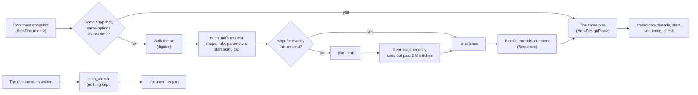

# Embroidery

> **Last reviewed:** 2026-10-24 · **Last updated:** 2026-10-24 · **Change:** VectorCraft merged in: the status bar's counters in its new fixed slots, Turkish; earlier: the stitch preview's review round: the Sewing order on the plan it shows, a drop at its rows' own place refused, memory bounded across documents, the fork's own settings folder; Using it › Seeing the stitches and the sewing order, and Files, brought up to date. Earlier changes: [Revision history](#revision-history)

VectorCraft turns artwork into machine embroidery and opens embroidery designs as art. The work
lives in the `vectorcraft-stitch` crate (`crates/stitch`): stitch planning from geometry, the
machine formats, and the thread palettes the formats name colours from. The engine adds the
commands: `document.open` reads a design, `document.export` writes one.

Everything is implemented from public format documentation — the formats were reverse-engineered
publicly long before this project (see [References](#references)); no proprietary software was
observed, and no GPL implementation was read or copied.

**Contents:** [Terms](#terms) · [Using it](#using-it) (writing and reading designs, the read commands, [seeing the
stitches and the sewing order](#seeing-the-stitches-and-the-sewing-order)) · [How a shape becomes stitches](#how-a-shape-becomes-stitches) ·
[The formats](#the-formats) · [What is not stitched](#what-is-not-stitched) · [Validation](#validation) ·
[Architecture](#architecture) · [References](#references) · [Files](#files) ·
[Revision history](#revision-history). The fork's own instructions and the project owner's
decisions are in [FORK.md](../FORK.md).

## Terms

- **Needle point:** where the needle goes down. A **stitch** (a *needle-down stitch*) is the
  thread laid from one needle point to the next without lifting the needle.
- **Record:** one entry of a machine file: a needle point, a jump or a cut. *Record numbers*
  count every record from 1 in sewing order.
- **Jump:** a move with the needle up. **Trim** (or *cut*): the thread cut, before a long jump or
  after an object that asks for it. **Tie** (*lock*): a few tiny stitches back and forth that
  hold the thread at the start and end of a run, so a cut can't pull it out.
- **Run:** a stretch sewn without lifting the needle. **Travel run:** short stitches that carry
  the needle inside a shape from one place to another, hidden under what is sewn next.
- **Block:** the stitches sewn in one thread, between two colour changes. **Sewing unit:** what
  is planned as one: one fill or one stroke of an object, or one run of stitches opened from a
  file.
- **Running stitch**, **satin** (a column sewn across, side to side; its two sides are its
  *rails*, the points matched across it its *stations*) and **tatami** (a fill of rows; the rows
  of one shape split into *regions* where the shape branches).
- **Underlay:** stitches sewn under the art first, to hold the fabric. **Pull compensation:**
  stitches reaching a little past the edge, since the thread pulls the fabric in;
  **push compensation:** a satin's ends sewn a little short, since sewing pushes the fabric out
  there.
- **Palette:** the threads a format numbers (Brother's for PES and PEC, Janome's for JEF).
  **ΔE₀₀:** the CIEDE2000 colour difference between an art colour and a thread's.

## Using it

**Writing a design.** Draw the artwork as usual and export it (the whole document's visible art,
or with `selectedOnly` the selected art alone):

```json
{"id": 1, "method": "engine.execute", "params": {"command": "document.export", "params": {"format": "pes", "spacing": 0.4, "angle": 45}}}
```

`document.export` writes the whole document's visible art unless `selectedOnly` is given. The file
goes to `path`, or comes back as `dataBase64` when no path is given (that is how the tests and the
control channel use it). Every writable format's options are listed by `document.formats`.

| Option | Earlier name | Default | Meaning |
|---|---|---|---|
| `stitch` | `stitchStyle` | `auto` | `auto` fills fills (their narrow parts as satin columns, see `narrowAsSatin`), satins strokes 1 mm and wider, runs narrower ones; `tatami` (or `fill`), `satin` and `running` force one style (`tatami` on a stroke fills the area the stroke paints, at its width, caps and joins; on a fill it sews all of it as tatami; `satin` on a fill, which has no width to sew across, fills it as `auto` does, its narrow parts as satin columns; `running` on a fill follows its outline) |
| `spacing` | `density` | 0.38 mm in fills; satin by width | distance between threads: between a fill's rows; between two penetrations on one rail of a satin column (peak to peak), its crossings lying half that apart. Left out, a satin column picks it by its width (*auto spacing*: 0.5 mm under 2 mm wide, 0.45 under 4, 0.4 under 6, 0.37 wider; estimates), and both follow `threadWeight`; given, it is used as it is. 0.05 to 5 mm |
| `length` | `stitchLength` | 4 mm in fills, 2.5 mm in running lines | the longest stitch of a running line or a fill row; 0.2 to 12 mm |
| `angle` | `stitchAngle` | 135° | the direction a fill's rows run, degrees counter-clockwise on the page as every angle in VectorCraft (0: left to right, 90: bottom to top); the default runs from the top left to the bottom right; any angle |
| `pull` | `pullCompensation` | 0.2 mm | pull compensation: how much farther the stitches reach at each side so the fabric's pull leaves no gap: each rail of a satin column, each end of a fill's rows. One number for both sides, or two: `[left, right]` of a satin as its path runs, `[start, end]` of a fill's rows along their direction; 0 to 2 mm a side |
| `pullPercent` | `pullCompensationPercent` | 0 | pull compensation that grows with the stitch, on top of `pull`: percent of a satin column's width, or of a fill row's length, added at each side (at most 2 mm a side with the fixed value). One number or two, as `pull`; 0 to 50 % |
| `push` | `pushCompensation` | 0 mm | push compensation: how much shorter an open satin column is sewn at each end, since sewing pushes the fabric out there; one number or two (`[start, end]` as the path is drawn). A fill's narrow part sewn as satin is shortened only at an end where the shape ends, not where it meets the rest of the fill. A column keeps at least half its length; 0 to 5 mm an end |
| `narrowAsSatin` | | 7 mm | a filled shape's parts narrower than this are sewn as satin columns that follow the shape, the rest as tatami; 0 sews every fill as tatami; 0 to 12 mm |
| `expand` | | 0 mm | how far a filled shape grows all round before it is stitched, so that neighbouring shapes drawn apart meet; negative shrinks it; −2 to 2 mm |
| `threadWeight` | | 40 | the thread's weight (wt: kilometres per kilogram, so a larger number is a finer thread): the default spacing of fills and satin columns follows its thickness (fill rows 0.44 mm apart for 30 wt, 0.31 for 60); 10 to 150 |
| `underlay` | | `true` | what is sewn under the art first: `true` or `auto` (by the shape: under a satin column a centre run, an edge run from 2 mm wide, an edge run and a zigzag from 4.5 mm; under a fill an edge run, and sparse tatami when it is at least 10 mm across), `false` or `none`, or one kind for every shape: `center`, `edge`, `edgeZigzag` (a satin's; a fill takes `edgeTatami`), `edgeTatami` (a fill's, whatever its size; a satin takes `edgeZigzag`) |
| `jumpLength` | | 5 mm | a longer move lifts the needle (a jump), tied off before and in after so that it can be cut; a shorter move that can't be sewn (between separate pieces) jumps with the thread on; 0.5 to 20 mm |
| `trimLength` | | 10 mm | a jump longer than this cuts the thread first (a trim); shorter jumps are left for the machine or a person to cut. From `jumpLength` (only a jump is cut) to 1,000 mm |
| `minStitch` | | 0.4 mm | shorter stitches are left out; 0.05 to 3 mm |

**One vocabulary.** These names are the ones the per-object settings will use, so that a value
resolved for an object can say which layer it came from (object, export option, document,
default) under one name. The earlier names are still taken, as aliases: a request may use either,
not both for one option. A value outside its range is refused with the range in the message, not
clamped; the ranges are the stitch planner's (`plan::*_RANGE`), and a test keeps the descriptions
`document.formats` lists equal to them. `null` leaves an option unset. Every read command
(`embroidery.stats`, `sequence`, `check`, `threads`) echoes the options it planned with, under
`options`, with the new names.

An option left out keeps the style's own value. The defaults are the stitch planner's
(`plan::Params::for_style`, or `plan::Params::for_thread` for another thread weight);
`document.formats` lists the same ones, and a test keeps them equal. Compensation and the thread
weight are one value for the whole design for now: settings per object come with embroidery
properties on objects.

**Spacing by thread weight.** The default spacings are for 40 wt thread, standard embroidery
thread, and follow the thread's thickness for others. Thread weight counts kilometres of thread
per kilogram, so a thread's cross-section is inversely proportional to it and its thickness to its
square root: spacings scale by `(40 / weight)^½`, so fill rows lie 0.44 mm apart for 30 wt, 0.38
for 40 and 0.31 for 60. Madeira's stitch density chart, by thread, follows the same curve (0.80,
0.50, 0.40 and 0.35 mm for its Classic 12, 30, 40 and 60 wt; this gives 0.73, 0.46, 0.40 and 0.33
from 0.40; its 75 wt, 0.20 mm, is finer than the curve). The chart is for satin; fills follow it
too here, an estimate: no source found scales fill spacing by thread. (A first version followed
the fourth root, sized to Wilcom's satin auto spacing offsets per thread class, 0.01 to 0.06
with no unit stated, read as millimetres, an assumption; against Madeira's chart that changed spacing about half as much as threads
do.)

**Reading a design.** Open the file as a document; `File → Open` lists the formats. Each colour
block becomes a group named after its thread, and each run of stitches a thin line, round at its
ends and turns (a mitred turn would draw a spike past a satin's sharp zigzag), in
the thread's colour, so the design looks like it will sew and can be measured, traced over or
recoloured. A DST, TAP, T01 or EXP file carries no colours: those blocks get the colours of a
fixed list (`thread::DEFAULT`), one per block. A PES, PEC or JEF file sets the document's thread
palette to its own format's (Brother's or Janome's, below), so each block is matched to the thread the file names
(ΔE 0). A number that names no thread of the palette (0, which the formats leave for "no colour",
or one past the palette's end, which only a damaged file or a newer chart holds) reads in that
block's colour from the same fixed list, its group named after the number ("Unknown thread 79"):
no number wraps round to another thread. A VP3 file gives each block's own colour and its
thread's description (else its catalogue number), which names the group; it sets no palette.
Each of the block's runs keeps its thread record (catalogue number, description, brand, material
and weight), which the VP3 export writes back as it was.
`design.pes` opens by its `#PES` bytes, `design.pec` by its `#PEC` bytes and `design.vp3` by its
`%vsm%` bytes, whatever they are called.

**Exporting what you read.** The lines of an opened design are its stitches: each one is marked
as a run of literal stitches (`NodeExtras::embroidery`, kept in `.vectorcraft` files), and the
export sews its points exactly as they are, one needle point per point, with the jumps and trims
the file had between runs. The runs of one thread group stay one colour block, and the export
options (`stitch`, `spacing`…) don't touch them. So a design opened and written again, in the
same format or another, has every needle point, trim and colour block where the file had it (see
`an_opened_design_is_written_back_unchanged` in `crates/engine/src/cmd/fileio/tests_embroidery.rs`).
The design keeps the name its file gave it (DST's and PEC's `LA:` label), which the export writes
again, not the file's name the document is called by; `embroidery.settings` shows it as `label`,
and `embroidery.setup {label}` changes or unsets it (unset, the export writes the document's
title). Put inside a clip group, the lines are cut to the clipping path as any stroke is, and the
needle lifts across each cut the same way (tied off and in around a long jump).
Moving or scaling the lines moves or scales the stitches; editing a line's points edits the
stitches. Turning a design back into shapes that are stitched by the rules (what professional
software calls recognising objects) is not done yet.

**Saved by upstream VectorCraft.** Upstream keeps the document's embroidery settings it doesn't
know but drops every object's (its node format keeps no unknown keys): a design opened from a
machine file, saved by upstream VectorCraft and opened here again is art, its lines stitched as
thin strokes and its Trim After marks gone, with no warning (FORK.md › Keeping up with upstream).

**What opening leaves out.** Opening a machine file says, one note each, what the file holds that
reading it leaves out, and so a file written from the document lacks (`Format::losses`): a PES's
own section before its PEC part (what PE-Design edits: a PES written here holds its stitches
alone), preview pictures that aren't blank, thread numbers that name no thread of the palette
(PEC's 62 to 64, which mark appliqué, written as the nearest thread), a JEF header's date and
version and a hoop larger than the design needs, a DST header's end position and multi-volume
fields (`AX`, `AY`, `MX`, `MY`, `PD`), VP3 threads that twist several colours (read in their first)
and a VP3's several designs (read as one). These are upstream's import losses: writing over the
file that was opened is then refused until `acknowledgeLoss: true` is passed, and the app asks
first (project owner's choice, 2026-10-22). What a design keeps instead is kept: its needle points,
trims and colour blocks, each block's thread (a VP3's thread record too), its name and where it
starts. Every real PES in the corpus says it loses its own section and previews (the cat face and
the fox an entry 62 too), the fox's JEF its date; the VP3 files lose nothing.

**Cutting the thread after an object.** `embroidery.setTrimAfter` (`{on?, ids?}`, the selection
by default) marks objects or groups whose thread is cut after their last stitch, however near the
next object starts, as Ink/Stitch's and Wilcom's "Trim After" do, in every format. Unmarked, only a
jump longer than `trimLength` is cut; off also takes away the cut a run of stitches opened from a
file had after it. Left out, `on` toggles: on, unless every object is marked already. The mark is
saved in `.vectorcraft` files (`NodeExtras::embroidery`). No menu or panel sets it yet: the command
palette runs it on the selection (Embroidery Trim After), and MCP and the control channel with
ids; an id that names no object is reported as a missing object.

**Threads.** Each colour block is sewn in a thread of the document's thread palette: Janome's 78
threads, which JEF files number (`jef`), or Brother's 61, which PES files number (`pec`) among 64
entries: the last three, 62 to 64, are the format's appliqué entries (EduTechWiki names them
Applique Material, Applique Position and Applique), not threads, so no colour is ever matched to
them, the export never writes them and the swatch library leaves them out. A file that names them
(the real designs' fox, digitized with Ink/Stitch, names 62 and 63 for its orange and its light
yellow) opens in their colours; written again, those blocks get Brother's nearest threads.
`embroidery.setup {palette}` sets it in one undo step, saved with the document, and
`embroidery.settings` reads it: the palette as stored, and the one in use with where it comes from
(`resolved: {palette: {value, source}}`, the shape every resolved setting will take). Unset,
Janome's is used (the project owner's choice, not a sourced default). The blocks are matched in sewing order:
a block whose art colour (its objects' fill or stroke) is a thread's own colour is sewn in that
thread, and every other block in the thread that looks nearest, the smallest CIEDE2000 colour
difference (ΔE₀₀, below). When a neighbouring block has that thread (the block before, or the
block after when its thread is already known), the block takes the nearest thread neither
neighbour has, so that the machine's colour change changes thread, as long as that one is still
similar, within ΔE₀₀ 10; otherwise it keeps its nearest thread, and the machine stops between two
blocks of one thread. The palettes are built-in swatch libraries (Window → Swatch Libraries → Embroidery
Threads: Brother Threads (PEC) and Janome Threads (JEF), each thread a swatch named by its
palette, number and name, "PEC 5 Red"). Art painted with a swatch of the document's palette is
sewn in that thread exactly (ΔE 0); a swatch of the other library is matched like any colour,
though the export in its own format still writes that thread. Image Trace takes them as its
Document Library palette, so a traced image comes out in threads. `embroidery.threads` (with the
export's embroidery options, and no other key) lists each block's art colour, its thread (palette,
number, name, colour) and the ΔE₀₀ between them, to two decimals, and flags as a mismatch a thread
farther than 10 as shown, one that looks clearly unlike the art; the same line decides when a block
takes another thread than its neighbour's. It is an estimate, the project owner's choice, by
judgement: past about 5 two colours side by side are already seen as different (Mokrzycki and
Tatol's bands, drawn up for the older CIE 1976 difference, which is not on CIEDE2000's scale), but
61 or 78 threads lie farther than 5 from about half the colours of real art (23 and 28 of the real
designs' 44 blocks). The JEF export writes the plan's threads when the
document's palette is Janome's, the PES export when it is Brother's; the other format matches the
art colours to its own palette by the same rule. DST, TAP, T01 and EXP name no threads, and VP3
writes each block's colour (and its thread's name) instead of a number.

A colour difference: the art's sRGB colour and the thread's are put in CIE L*a*b* (D65), and
CIEDE2000 measures between them as the eye sees it, where RGB distance weighs the three channels
alike. About 1 is the smallest difference seen side by side (a rule of thumb from the older CIE
1976 difference). CIEDE2000 was fitted to small differences: its standard, and Sharma, Wu, Dalal
and Celik (CIC 12, 2004, [art00058](https://library.imaging.org/cic/articles/12/1/art00058)),
advise keeping it within about 5 CIELAB units, where its discontinuities stay under 0.3. Thread
matching works past that (a median of 5 to 6 on the real designs), so which of two far threads is
nearer is less sure than which near one is; the project owner chose CIEDE2000 over OKLab all the
same. A teal, `#339999`, is nearest
Brother's Sky Blue by RGB (ΔE₀₀ 20.2) and Teal Green by eye (9.8); a dark grey, `#31373d`, was
Janome's Olive Green by RGB (24.3) and is now its Dark Gray (12.6).

**Replies.** The read commands below share one vocabulary. A *record* is every needle point, jump
and cut the plan holds; *record numbers* count them from 1 in sewing order (`firstRecord`,
`lastRecord`, a check hit's `record`), while `stitches` counts needle points only, so a block's
`records` is its `lastRecord − firstRecord + 1`. Every block's thread is one object, `{palette,
index, name, color, art, deltaE, mismatch}`, in every reply. Counts are named `…Count`
(`blockCount`, `unitCount`, `threadCount`), lists by plural nouns; counts and whole seconds are
integers. Lengths, positions and boxes are millimetres from the document's origin with y down,
boxes `[left, top, right, bottom]`; thread is in metres, named so (`topMetres`). A list that can
grow with the design takes `offset` and `limit` (at most 10,000; 1,000 by default) and says how
many items there are and whether some after the listed ones were left out (`truncated`). Fields a
client acts on are ids, with the prose beside them for display. Replies change only by addition:
a test pins each one's keys and types (`cmd/embroidery/tests_contract.rs`).

**What they plan.** Each read command plans what the export writes: the document as it is, or
with `selectedOnly` the selected objects alone (as `document.export {selectedOnly}` writes them),
and without an opacity mask's editing layer, which no export writes.

**A design's figures.** `embroidery.stats` (with the export's embroidery options, `speed`,
`fabricThickness`, and `offset` and `limit` for its blocks) gives the figures of the design the
export would sew, for the whole design and for each block:

- counts: needle points, records (needle points, jumps and cuts), jumps, trims, colour changes,
  distinct threads, blocks;
- size: the needle points' box, the start and end points (the first and last needle points), and
  the extents from the start (left, right, up and down, as Wilcom's Design Information lists them);
- lengths: the shortest and longest needle-down stitch, and the longest jump. A *needle-down
  stitch* is the thread laid from one needle point to the next without lifting the needle: a jump,
  a cut, the needle point a jump lands on and the move between two blocks are none;
- thread, an estimate: metres of top and bobbin thread;
- sewing time, an estimate, and the colour changes counted apart (`colorChanges`).

The thread and the time follow the shape of what Wilcom documents for its own estimates, which it
publishes without formulas or values, and every number is a named constant with its source or
marked as an estimate (`cmd/embroidery/stats.rs`):

| Value | Default | Source |
|---|---|---|
| top thread per needle-down stitch | its length on the face, and the share of its length on the back that is top thread pulled under | the balance thread makers teach: the back of a satin is ⅓ bobbin, ⅔ top thread pulled under ([Madeira](https://www.madeira.com/fileadmin/user_upload/Downloads/HowTo/EN_Avoid_Puckering.pdf), [American & Efird](http://www.amefird.com/wp-content/uploads/2010/02/EmbroideryUnqualityMatrix-2-11-10.pdf)) |
| bobbin's share of the back (for the top thread) | ⅓ under a satin, ⅓ × 125 / 65 under running and tatami, ⅓ × 100 / 65 for stitches read from a file | Wilcom's bobbin factors: 100 % for a mixed design, about 125 % for one all of run or tatami, about 65 % for one all of satin ([thread usage](https://docs.wilcom.com/embroiderystudio/28/en/OnlineHelp/Basics/threads/threads-5.htm)); anchoring satin at ⅓ is ours, an estimate |
| bobbin thread | 3/5 of the top thread | Madeira's rule of thumb for standard-length stitches, about 3 m of bobbin to 5 m of top thread a 1,000 stitches ([density sheet](https://www.madeirausa.com/_resources/common/userfiles/file/Resources/TH.Reads/Density.pdf)); the project owner's choice of calibration (2026-10-22), an estimate. Scaled by Wilcom's factors instead, the real designs' plans came to 4 m a 1,000 needle points |
| top thread through the fabric | twice `fabricThickness` per needle point (down and back up) | an estimate; Wilcom takes the fabric's thickness as an input |
| `fabricThickness` | 0.5 mm (0 to 5) | an estimate (a medium cotton, a T-shirt jersey) |
| `speed` | 650 stitches a minute (60 to 1500) | the default of Janome's Memory Craft 230E's maximum-speed setting, which runs from 400 to 650 ([MC230E manual](https://www.janome.ca/wp-content/uploads/2025/02/inst-manual-mc230e.pdf), which also advises slowing down for small designs); commercial machines usually run at 700 to 800 (Wilcom's blog, below); an estimate for home machines. The bounds: Janome's [Memory Craft 9850](https://www.janome.com/product/memory-craft-9850/) embroiders from 60, Happy's HCU2-1501 at 1,500 ([a dealer's listing](https://shop.coldesi.com/products/happyjapan-hcu2-1501-embroidery-machine-hcu2-1501)) |
| slow speed | 400 stitches a minute, for stitches and jumps longer than 4 mm | the lowest Janome's home machines can be set to (same manual); Tajima's TMEZ-SC keeps its top speed up to 4 mm ([product page](https://www.tajima.com/product/tmez-sc/)): both estimates for home machines, after Wilcom's "slow above" ([runtime settings](https://docs.wilcom.com/embroiderystudio/e4/en/MainHelp/Setup/hardware/Configure_machine_runtime_settings.htm)) |
| trim | 3.5 s | 3 to 4 s by machine, Wilcom's blog ([high-impact, low stitch-count designs](https://wilcom.com/resources/blog/high-impact-low-stitch-count-designs)); another Wilcom post was reported to give about 8 s, but no longer opens |
| thread change | not timed: counted apart | a person rethreads a single-needle machine; Brother's machines leave thread changes out of their own estimate, and trims too ([Brother](https://support.brother.com/g/s/hf/htmldoc/hsm/om/888p5x/en/06_08_01.html)), so a Brother machine's display differs from this one by the trims |

So each needle point and jump is one turn of the machine at the normal or the slow speed, each trim
takes 3.5 s, and the start and end of the design are not timed. The counts and the time are the
plan's records: a file may hold more (a DST trim is three jump records, a move longer than one
record holds is several, the VP3 writer adds a zero-length stitch after each long move;
`formatStep` counts a stitch's); the answer says what the time
includes, and marks the thread and the time as estimates (`estimate`: what each rests on). All
these numbers stay estimates until they are measured on machines (the project owner's choice,
2026-10-22). On the real designs VectorCraft's plans use 4.7 to 5.6 m of top thread and 2.8 to
3.4 m of bobbin thread a 1,000 needle points, within 12 % of Madeira's 5 m and 3 m (the people's
denser designs within 39 %; `embroidery_planning.rs` checks both), and the real designs' watermelon (46 × 32 mm, 1,535 needle points) sews in about 2.5
minutes at 650 stitches a minute. Values out of range are refused, not clamped.

**The sewing order.** `embroidery.sequence` (with the export's embroidery options, and `offset`
and `limit` for its units) lists the design as it is sewn, read only: the blocks in order, each
with its thread, needle points, records and record numbers, jumps and trims, and what follows it
(a colour change, after a cut when the block ends with one); in each block, its units in order,
each with the object a person selects (`id`: the symbol instance for art inside a symbol, with the
object sewn as `node`), the part (`part`: `fill`, `stroke`, or `literal` for a run opened from a
file, and `partIndex`, which fill or stroke from 1), how it is sewn (`sewn`: `running`, `satin`,
`tatami` or `literal`, the words the `stitch` option takes, and `columns` when a fill's narrow
parts are satin columns; as the planner sews it: a fill under `stitch: satin` has no width to sew
a satin across and is filled, so it is listed as tatami) and why: the rule that chose it as an id
with the values it turned on (`rule: "wideStroke"`, `ruleValues: {width: 2.12, satinFrom: 1,
widest: 10}`) and as a sentence (`why`: "a stroke at least 1 mm wide is a satin column, here 2.12
mm"); and its needle points, records and record numbers, jumps, trims, entry and exit points and
box. What tells a unit apart is `id` (the object a person selects: the object itself, the symbol
instance that places a symbol's art, or the object an expanded appearance's pieces come from),
`part`, `partIndex` and `occurrence` (which unit of that object and part it is, from 1 in walk
order: one instance's symbol paths, or an expanded object's pieces, often share a part, "fill 1").
The four are unique within a plan, and stay the same from one plan to the next while the object
and its own art (its symbol's paths, the pieces its appearance expands to) keep their number and
order. `unit` is a position in one plan; `node`, the object sewn, is no key: an expanded object's
pieces get new ids at every plan, and a symbol's paths are the same nodes in every instance. A
selection maps to units through `id` (and the objects that hold it), never through `node`. `split` names the objects whose units are sewn in more than one
block (an object filled in one thread and stroked in another always is). Sewing order follows stacking order: moving objects (`node.move`) changes it,
and objects of one colour (the same art colour, before threads are matched) still join where
nothing lies between them: their boxes, grown by 1 mm, overlap none of the blocks sewn between.
Two art colours a hair apart that match one thread are two blocks, sewn in that thread with a
machine stop between them when they are neighbours (the project owner's choice, 2026-10-22).

**Checks.** `embroidery.check` (with the export's embroidery options, `format`, `rules` and
`limit`) runs design checks on the plan. Each rule gives its threshold, its unit as a token (`mm`,
`stitches`, `units`, `deltaE`, `blocks`, `colorChanges`) and what its values measure, its sources
(where two sources disagree, both are listed and the first is the one checked), its severity
(*error*: the format can't hold it; *warning*: the quality may suffer; *info*), the number of
hits, the objects hit (`objectCount`, at most 1,000 listed, `truncated` when more) and the first
`limit` hits (`examples`, 20 by default, at most 1,000) as record numbers and points with the
measure compared with the threshold (for `formatStep` the stitch's longer extent along x or y,
with its own length and the records it is written as beside it; a stitch's hit also gives where the
stitch starts, a thread's its block and thread, a `notSewn` hit the objects whose art it left out,
which the plan keeps for each warning, at most 1,000). Each rule also gives `measured`, the extreme
of what it judged, hit or not: the longest stitch, the shortest, the widest column, the most layers
on one spot, the largest colour difference, the design's blocks. The summary gives, for each
severity, how many rules found something and how many hits they found. `embroidery.stats` gives the
needle-down stitches by length (`lengths`: half-millimetre bins up to 12.5 mm, one up to 12.7 mm and
one for every longer stitch, which holds exactly `stitchTooLong`'s hits) and their median. `format` (the document's thread palette's
format when left out: PES for Brother's, JEF for Janome's; with Janome's, the default, the colour
limit of `formatColors` never fires, since JEF has none: ask for `format: "pes"` or `"vp3"` to check
theirs) decides the format limits checked, and the threads judged: those the format writes, matched to
its own palette when it numbers its threads from another than the document's (`palette` names it).
Melco's design checker works on a design's objects and their settings (many of the issues it
flags "can be addressed with simple object property changes"), so its fill, satin and walk-stitch limits are checked on each
object's settings and report the objects: its fill or running stitch length, its satin columns'
width. Stitches read from a machine file have no such settings and those three rules pass them by.
The other length rules measure needle-down stitches, a unit's underlay, travel and tie stitches
included.

| Rule (`id`) | Flags | Severity | Sources |
|---|---|---|---|
| `satinTooWide` | a satin column wider than 10 mm (a satin stroke's width; a fill's widest narrow part) | warning | Melco DesignShop v11's design checker, 10 mm ([user manual](http://www.melco-service.com/docs/DSv11_Manual.pdf), Design Checker Tab, p. 38); Wilcom: keep satin widths within 10 mm ([satin and tatami](https://wilcom.com/resources/blog/mastering-basic-stitch-types-satin-stitch-and-tatami-stitch)); Ricoma: shapes 12 mm and wider are usually not satin ([digitizing tips](https://www.ricoma.cn/cn/ndetail13_604)) |
| `stitchTooLong` | a stitch longer than 12.7 mm | warning | Melco's design checker |
| `formatStep` | a stitch longer along x or y than one record of the format holds: DST, TAP and T01 12.1 mm, EXP, JEF and VP3 12.7, PES and PEC 204.7. Our writers write it as several stitches of equal steps (the hit says how many; they round each end to 0.1 mm first, so within a tenth of a millimetre of a multiple of the step it gives both counts), so the machine sews more needle points than planned | info | the formats' pages on EduTechWiki; `Format::max_step`, read from each writer |
| `fillStitchShort` | a fill's stitch length set shorter than 2.5 mm (the object's setting) | warning | Melco's design checker, 2.5 mm; Melco's machine manual: fill stitches ideally 2 mm or longer ([Melco OS manual](https://www.melco-service.com/docs/X/melco-os-ai-en.pdf), pp. 301–302) |
| `satinStitchShort` | a satin column narrower than 1 mm (a satin stitch spans its column): a stroke forced to satin that narrow. A fill's narrow parts that narrow are running lines, not satin, so they never fire it | warning | Melco's design checker; Melco's machine manual agrees |
| `runStitchShort` | a running line's stitch length set shorter than 1.5 mm | warning | Melco's design checker; Melco's machine manual agrees |
| `stitchBelowNeedle` | a stitch shorter than the needle's blade, 0.75 mm for a 75/11 | info, until the planner spreads a fill row's remainder (its rows end in stitches of 0.4 to 0.75 mm today); then a warning | Melco's machine manual: keep stitches longer than the needle's blade (pp. 301–302), 0.75 mm for a 75/11 (p. 202) |
| `stitchTiny` | a stitch of 0.3 mm or less, which machines delete | warning | Brother's machines delete stitches of the set pitch or less, 0.3 mm as they come ([PRT23 manual](https://download.brother.com/welcome/doch102354/prt23_om01ja.pdf), printed p. 108, p. 110 of the PDF); Ricoma advises digitizers to delete stitches under 0.3 mm ([digitizing tips](https://www.ricoma.cn/cn/ndetail13_539)) |
| `shortStitchesInARow` | more than 5 stitches in a row, each shorter than 1 mm (a jump, a cut or a thread change ends a row) | warning | five is an estimate: no source gives a limit for runs of tiny stitches; Wilcom's Shortening effect shortens up to five satin stitches in a row on a tight curve, a setting of that effect, not a quality limit ([help](https://docs.wilcom.com/embroiderystudio/28/en/OnlineHelp/Quality/quality/quality-15.htm)); 1 mm is Melco's machine manual's general minimum |
| `layers` | three or more sewing units over one 1 mm square (the square an estimate; a stitch is counted at most at 64 points, every half millimetre along one up to 32 mm long, and at most 4 million squares are counted, bounds on the work a file can ask for) | warning | Brother's PRT51 manual: stitching sewn over three times or more can break the thread or the needle ([manual](https://download.brother.com/welcome/doch100486/prt51_om02ja.pdf)); Melco's design checker names "too many layers" without a number ([user manual](http://www.melco-service.com/docs/DSv11_Manual.pdf), p. 38) |
| `threadMismatch` | a thread past ΔE 10 as shown, as `embroidery.threads` flags it | warning | the project owner's choice (Threads, above) |
| `notSewn` | what the plan leaves out or approximates: its warnings (type, images, live art, patterns, gradients) | warning | What is not stitched, below |
| `formatColors` | more colour blocks than the format holds: PES and PEC 255 (the PEC header counts them in a byte), VP3 65,535 (a 16-bit word); DST, TAP, T01, EXP and JEF have no such limit | error | EduTechWiki's [PEC page](https://edutechwiki.unige.ch/en/Embroidery_format_PEC); for VP3 the KDE Community Wiki ([VP3](https://community.kde.org/Projects/Liberty/File_Formats/Viking_Pfaff)) and Jason Weiler ([VP3 File Format](http://www.jasonweiler.com/VP3FileFormatInfo.html)), while EduTechWiki's [VP3 page](https://edutechwiki.unige.ch/en/Embroidery_format_VP3) gives the summary's count as a byte (a reader that takes it so would miscount a design of 256 blocks or more); `Format::max_colors` |
| `machineStitches` | more than 500,000 needle points | info | Brother PR680W's manual: the `.pes` files it shows ([specifications](https://download.brother.com/welcome/doch102285/884t23_om01en.pdf)); one machine's limit, not the format's |
| `machineColorChanges` | more than 127 colour changes | info | the same manual |

Not checked: "density too tight", "too many needle penetrations in an area" and "too many or too
few tie stitches" (missed trims or starts), which Melco's design checker names without a number;
the answer lists them under `notChecked`. Melco's checker also names "too many layers" without a
number: the second source of `layers`.

What the rules find on the real designs (11 artworks digitized at the person's size, and the
person's Ink/Stitch files opened as stitches; `crates/engine/tests/embroidery_planning.rs` prints
each design's hits and the objects hit, rule by rule, with the default palette's format, JEF):
hits, then the objects hit and the designs, added up over the eleven.

| Rule | VectorCraft's plans (44 blocks, 25,662 needle points) | The person's files (42 blocks, 55,717 needle points) |
|---|---|---|
| `fillStitchShort`, `satinStitchShort`, `runStitchShort` | none: the default settings (4 mm fill, 2.5 mm running stitches, no satin column under 1 mm) pass | none: opened stitches have no settings |
| `stitchBelowNeedle` | 1,090 (61 objects, 11 designs): rows' remainders from 0.4 to 0.75 mm | 11,577 (92 objects, 11 designs) |
| `stitchTiny` | none: the planner leaves out stitches under 0.4 mm | 5,375 (74 objects, 11 designs) |
| `layers` | 1,250 squares (32 objects, 7 designs) | 741 (27 objects, 5 designs) |
| `threadMismatch` | 9 blocks (11 objects, 6 designs) | none: a file's own threads |
| `shortStitchesInARow` | none | 66 rows (39 objects, 8 designs) |
| the rest | none | none |

Measured once on 2026-10-22, before the project owner chose to read Melco's limits on settings:
checked stitch by stitch, Melco's fill limit flagged all 44 of VectorCraft's blocks (7,504
stitches, about 29 % of the needle points then: the 2 mm underlay and the rows' short ends); read
as Melco's checker reads it, on each object's settings, it flags none.

### Seeing the stitches and the sewing order

- **The stitches on the canvas.** View › Stitch Preview (⌘E), or the Art | Stitches switch at the
  canvas's top right, shows the active document's stitches in place of its art, on the fabric,
  each in its thread's colour; they are planned in the background with the export's options (those
  of the document's last embroidery export, else the defaults) and follow every edit. View › Stitch
  Preview Options: Show Jumps and Cuts, Show Needle Points, Show Artwork Under Stitches (faint, or
  its outlines in Outline) and Show Check Marks. As commands: `view.stitchPreview {on?}` and its
  options (`view.stitchPreview.jumps`, `needlePoints`, `artwork`); `embroidery.render` draws the
  same picture headless.
- **The Embroidery panel** (Window › Embroidery, docked beside Properties, Layers and Libraries) has
  two tabs. **Sewing Order** lists the thread blocks in the order they are sewn, each object's fill
  or stroke a row; a row hovered stands its stitches out on the canvas, a click selects its object.
  Drag a row to sew its object earlier or later (the hint under the list says where it goes, or why
  it can't), or use a selected row's ↑ and ↓ and the panel's ≡ menu: Sew Earlier, Sew Later, Sew
  First and Sew Last (also the commands `embroidery.sewEarlier`, `sewLater`, `sewFirst` and
  `sewLast`, with no default shortcuts). The sewing order follows the stacking order, so each moves
  the object in the stack, as one undo step. **Check** shows `embroidery.check` for the format chosen ("Checked for"), problems
  first; Show selects a rule's objects and zooms to its hits, Next and Previous Finding step
  through them, and rings mark them on the canvas.
- **The status bar** shows the design's figures (stitches, colours, thread changes, the time) while
  the stitches or the panel are shown; a click opens the panel.

How it is planned and drawn: [Planning for the stitch preview](#planning-for-the-stitch-preview)
and [Drawing stitches](#drawing-stitches), under Architecture.

## How a shape becomes stitches

A *run* is a stretch sewn without lifting the needle. Runs are joined into a block: a short move
inside the shape (`jumpLength` or less) is just the next stitch; a move that can't be sewn (it
would leave the shape or cross a hole) jumps. A short jump keeps the thread on (it leaves no tail
worth cutting). One longer than `jumpLength` is tied off before and in after, so that the machine
or a person can cut it without the stitching coming undone, and the thread is cut first (a
*trim*) only when the jump is longer than `trimLength`, 10 mm by default. That follows what the
tools and machines do: Ink/Stitch adds a trim only where an object asks for one ("Trim After") and
otherwise ties jumps longer than its minimum jump length
([fill stitch](https://inkstitch.org/docs/stitches/fill-stitch/),
[preferences](https://inkstitch.org/docs/preferences/)); Wilcom trims when the next connector is
longer than a length the user sets
([automatic trim settings](https://docs.wilcom.com/embroiderystudio/27/en/OnlineHelp/Quality/connectors/connectors-8.htm));
and machines with jump trimming cut the jumps longer than a length set on the machine, Brother's
from 5 to 50 mm
([Brother](https://support.brother.com/g/s/hf/htmldoc/hsm/om/888p5x/en/07_03_07.html)). A trim
costs machine time and risks the thread pulling out, while a jump nobody cuts lies loose (and
entry-level machines don't cut jumps themselves). The default, 10 mm, is a choice between those, not
a published value: hops between letters or seeds stay jumps, and longer loops are cut in the file. Each colour block is one
thread. Satin and fill tie the thread in at the start and after every long jump, and off before
every long jump and at the end: a short stitch back and forth on the spot. A stitch shorter than
`minStitch` is left out, as professional software removes them: it can break the thread or cut
the fabric.

- **Running** follows a path at `length` steps, with a lock stitch (a short stitch back
  along the line and forward again, never past its end) at each end so the thread does not pull
  out; a closed line too, where it starts and ends. Sharp corners (turns over about 30°) get a needle point of their own, so the stitches follow
  the outline instead of cutting across a corner; the same holds for underlay. A point that would
  fall within 0.3 of a stitch of a corner moves onto it, once at most: a corner that close to one
  already stitched into is passed, so along a fine zigzag the stitches keep their length (at most
  1.3 stitch lengths) instead of one point moving from corner to corner.
- **Satin** sews a column: the path is its centre line, its stroke width the column's width, and
  the needle crosses from rail to rail, so the threads lie side by side. The column's spacing is
  measured between two penetrations on one rail (peak to peak), as Madeira's thread chart,
  Ink/Stitch and Hatch measure a satin's density, so its crossings lie half that apart: more open
  in a narrow column, where the thread bunches at the rails, denser in a wide one so it covers (or
  `spacing`, when given). A 5 mm column at 40 wt (0.40 mm) puts 50 crossings in a centimetre;
  Madeira's chart gives 51 for 40 wt. (Until this was settled the crossings lay a whole spacing
  apart, half as dense as meant: the satins the person sewed in the real designs below lie
  0.41–0.42 mm apart on a rail, as Ink/Stitch's default 0.4 mm does, and VectorCraft's lay about
  1.08 mm apart.) Pull compensation widens the column at each rail: a fixed
  `pull` (0.2 mm, Wilcom's starting value for drill and cotton) plus, if asked,
  `pullPercent` of the column's width, which gives wide columns more than narrow ones
  (as Ink/Stitch's percentage does); each can differ between the rails (the left one as the path
  is drawn, then the right one), as Wilcom's double-sided compensation does for a column that lies
  on fabric on one side and on other stitching on the other. Push compensation
  (`push`) shortens an open column at its start and its end, underlay and all: the
  stitches pile up at a column's ends and push the fabric out, so a column comes out longer than
  drawn (Wilcom's push and pull article, Ink/Stitch's push compensation). No starting value is
  published, so it is off by default. Every crossing goes across the column, the last one too (the
  last point's direction used to be taken as left to right, so a column running any other way
  ended with a stitch along it or on the rail the one before used). The underlay holds the
  column up and follows its width: a centre run under columns narrower than 2 mm, an edge run (along one side and back along
  the other, kept inside the column) from 2 mm, and an edge run then a zigzag between its sides
  from 4.5 mm (estimates from the usual practice). The top stitching starts where the underlay
  ended, so the needle never travels back along the column. A crossing longer than 10 mm is split
  (by judgement: Wilcom recommends an Auto Split of 7 mm and satin widths within 10 mm, Melco's
  checker lets satin stitches up to 10 mm pass; splitting at 7 would change every wider satin)
  into shorter stitches (*auto split*), and the cuts move from one crossing to the next so they
  never line up into a seam down the column. The underlay is split the same way: a zigzag's
  stitches run at an angle and are longer than the column is wide, and Ink/Stitch's underlay guide
  warns that unbounded ones destabilise the column; so are the edge run's turn across the column
  and the stitch from one layer to the next. A column is at most 50 mm wide: a wider stroke is
  sewn 50 mm wide, and the export warns. Round a bend the crossings turn with the path and keep the
  spacing on the outer rail, as a fill's narrow columns do (below): each step along the centre line
  is shortened so that the farther rail moves on by half the spacing, and the inner rail, a shorter
  way round, takes its penetrations closer. A curve is flattened into short segments before it is
  sewn; along each the crossings' direction turns evenly from one gentle vertex (turning 30° or
  less) to the next, while at a sharp corner each side keeps its own. They used to stay square to
  each flattened segment and step at its ends: a 5 mm satin round a 6 mm bend had its outer rail's
  penetrations 0.40 mm apart along a segment and up to 0.97 mm where two met; now they are 0.40 mm
  apart all round, and its inner rail's 0.15 mm. So a path drawn as a polygon with gentle turns is
  sewn as the curve it approximates. Where a curve bunches the penetrations on the column's inner
  side, stitches there are shortened (*short stitches*, as Ink/Stitch's short stitch inset and
  Hatch's stitch shortening do): a penetration closer than half the spacing (the distance between
  crossings) to one of the last four on its rail moves in by 20 % of the column's width, or 40 %
  when that is still too close (when neither clears, the one farther from them). On a gentle curve
  every other inner stitch is shortened, on a tight one they spread over the two depths, and a
  straight column keeps its full width. A 5 mm column round a 3 mm radius had 16 of its 18 inner
  penetrations within 0.15 mm of the one before; now none is. The depths are estimates (15–25 % is
  the usual shortening).
- **Tatami fill** fills a shape with rows `spacing` apart at `angle` degrees, alternating
  their direction. The defaults, rows 0.38 mm apart and stitches up to 4 mm, are Wilcom's tatami
  defaults ([Wilcom: satin and tatami stitch](https://wilcom.com/resources/blog/mastering-basic-stitch-types-satin-stitch-and-tatami-stitch)),
  and 0.38 mm is the spacing David Morrish's *Digital Embroidery* (2025, ch. 2) gives for 40 wt
  thread without gaps (0.40 mm lies the threads flush). Fabrics that need more or less wait for
  fabric presets. A shape drawn without a final close is still filled, as paint fills it; only a
  subpath with no area is sewn as a line. The penetrations sit on a grid every `length`
  along the rows' direction, shifted a quarter stitch from one row to the next over a four-row
  cycle, so neighbouring rows — in any region — form one stagger pattern and never line up into a
  groove; no stitch is longer than `length` (an end stitch at most `minStitch` more, and
  its pull compensation), and only a row's first and last stitches are shorter. A row's last
  stitch is left out when it is short, so the needle turns diagonally into the next row instead
  of crawling along the edge (a region's last row keeps it: it has no next row to turn into, and
  a fill of one row would otherwise stop short of its edge); a
  long turn (where the edge runs nearly along the rows) is sewn as short travel stitches rather
  than one loose stitch; a turn between two rows that end on one straight edge runs along it. The rows are centred
  across the shape's extent, as many as the spacing fits (rounded): the margin is the same at both
  sides, a quarter to three quarters of a spacing, so no row lies on a tangent and the thread's
  width covers to the edge on both sides alike. Holes are left unstitched: the shape's fill
  rule decides what is inside, as it does for paint.

  Pull compensation stretches each row past the edge at its ends: the fabric draws a row in along
  its length, so a fill sewn exactly to its outline comes out narrower and leaves a line of
  background where it meets its neighbour (Wilcom: tatami fills are pulled less than satins, but
  noticeably over large areas). Each row's first and last needle points move out by
  `pull` (the first value at the rows' start, the second at their end) plus
  `pullPercent` of the row's length, as Ink/Stitch's fill pull compensation extends
  each row outward from its centre; at most half way to the next stretch of the same row, so rows
  either side of a narrow gap or hole meet in its middle at most, never across it (a hole
  narrower than twice the compensation is closed in the stitches; the fabric's pull opens it
  again). The rows reach along their own direction, so an edge they cross at an angle moves out by
  less: at 45°, 0.2 mm along a row is 0.14 mm square to the edge. The stagger grid, which row
  stitch is left out at a turn, and the order the regions and rows are sewn in are chosen as
  without compensation (moves are judged between the rows' ends on the outline): the compensation
  changes no sewing order. The stitches themselves are measured where they are, so a move within
  the compensation of `jumpLength` or `trimLength` can become a jump or a cut, as on any shape
  that grows (the real designs gained one trim). Only the rows' end stitches grow. The underlays
  get none: they stay inside the edge. `expand` grows the shape itself all round before it is filled (its union
  with a band twice as wide along its outlines, round at the corners; a negative value shrinks it),
  as Ink/Stitch's "Expand" does, for shapes drawn apart that should meet; a clip group cuts the
  grown shape, so it grows only where it shows.

  Underneath, an edge run half a spacing inside each outline (about where the outermost rows lie,
  so they cover it; a corner moves along its bisector, and stays put where that would leave the
  shape) holds the fabric, and a fill at least 10 mm across
  both ways also gets a second underlay: sparse tatami rows (2 mm apart, 3 mm stitches) across
  the top rows, kept 0.6 mm inside the edge so they never peek out (estimates).

  The rows are grouped into *regions* where the shape does not branch (above a hole, each side of
  it, below it; each arm of a letter), linked where they meet, and each region is sewn whole
  before the next, from whichever of its ends and sides is nearer the needle. Each region also
  takes one row of its neighbour's where they meet, cut to the stretch they share, so the fabric's
  pull opens no gap along the seam. The needle gets from one region (or outline) to the next by a
  *travel run*: 2 mm stitches along the shortest way that stays inside the shape, found on a
  visibility graph of the outlines' reflex corners (a shortest way turns at no other), each passed
  0.5 mm inside (as Ink/Stitch's "underpath" does). A travel under stitching still to come is
  hidden, so it may be any length (all of the underlay's are); one over the top stitching already
  sewn shows, and may show for at most 25 mm (an estimate); a way that would show more, or none
  (two separate shapes), lifts the needle instead. A move whose middle lies on the outline is
  checked stretch by stretch between the corners it passes: along two edges in line (the bottoms
  of two squares side by side) it used to be taken for a way inside, and the thread ran across the
  gap between them.

  The order of the regions decides how much travel shows. The pieces of a shape (regions linked
  to one another) are sewn one after another, the nearest next; in each, several orders are
  planned and the cheapest kept, counting travel that shows, hidden travel (it adds stitches),
  jumps and trims (weights chosen by judgement: a trim costs most, a visible travel much more than
  a hidden one). One order sews the nearest region next. The others each pick a region to sew last
  and sew every other region before the one it leads to, ending next to it, so that the way on
  always runs under regions still to come: the approach of US patent 6,397,120 (Soft Sight, 2002),
  which orders a fill's fragments by a walk from the one where sewing ends. In a letter E with
  vertical rows the arms are sewn first, each towards the spine, and the spine last: no jump and no
  trim at any angle, where the nearest-first order had to cut. A 30 mm ring with a hole and a
  puzzle piece are sewn without a trim. Up to 8 regions are tried as the last one (fewer in a
  piece of many regions), and a piece of more than 200 regions is sewn nearest-first.

  The corners' visibility is worked out once per shape, and the outlines' edges are sorted into a
  grid of cells, so that a test along a segment looks only at the edges in the cells it passes (an
  edge is listed only in the cells it passes through, and a shape whose edges would fill more than
  32 cells each on average, such as thousands of edges from corner to corner, keeps no grid and tests
  every edge: a grid of each edge's whole box took 0.8 GB for 20 000 such edges): a
  gear of 90 teeth with 24 holes plans in 60–90 ms (measured, release build) with 2–4 trims and as
  many jumps, where testing every edge against every corner took about 100 ms and gave up
  travelling (the graph was too large), ending with 25–34 trims and over 200 jumps.

- **Narrow parts as satin.** Satin covers a narrow part better than tatami: one long glossy stitch
  across it, where tatami's rows are a few short stitches long. Auto-digitizers choose by width
  too, object by object (here each part of a shape is chosen on its own), and one digitizing guide
  keeps satin to parts narrower than 8–10 mm, past which its stitches lie loose. So a filled shape's parts narrower than `narrowAsSatin` (7 mm, below that
  with room for pull compensation; an estimate) are sewn as satin columns, and the rest of the
  shape as tatami. Stripes, stems, rings, the strokes of a letter and the rind of a melon become
  columns; a square, a dot or a wide area stays a fill.

  *Finding them.* The outline is sampled every 0.25 mm. From each sample a ray goes into the
  shape, square to the outline, to where it leaves it. The two points are opposite each other
  when the ray is short enough, the outline there faces back within 60°, and the ray back from the
  far point lands near the first (within half the width): so a corner, or a round end looking down
  a stem's length, pairs with nothing. Samples whose opposite points move steadily the other way
  form a *side*, and two sides opposite each other are a column, matched point to point (its
  *stations*): a side is paired with the side most of its samples look across at or, when that
  makes no column, the next, so a bar's side that runs on along a thicker block at its end still
  pairs with the bar's other side. The rays leave square to the outline as the curve runs, its
  direction turning smoothly from one flattened segment to the next (with each segment's own
  direction, the far points moved in a sawtooth and a letter's curve broke into pieces); a point
  repeated where two flattened curves join is dropped first (there the turn stopped, the far
  points jumped, and a ring 3 mm wide or more broke open, a quarter of it left to the tatami). A
  ring (both sides all the way round) is a column that closes. At a pointed or round end the column follows the outline
  round the tip, its stations narrowing to it; at a square end it stops at the corners. A column
  may run on through parts up to half as wide again as `narrowAsSatin`, so that a stroke whose
  width wavers about the limit is sewn whole rather than cut into satin and tatami, but its
  typical (median) width must be within it, and a stretch wider than the limit may be no longer
  than twice the column's typical width within it: a longer one (the bowl at each end of a
  dumbbell, a knot on a stem) is cut out and left to the tatami, the column stopping either side
  of it, so a column does not fan across a wide part. A column must be twice as long as it is wide, so
  compact shapes stay fills, and one that lies mostly inside a longer one (the same part seen
  across) is left out. A letter T is three columns (the bar's two arms and the stem) and a square
  of tatami where they meet; an O is one column that closes and an S one column end to end.

  *Sewing them.* A column is a satin whose width follows the shape: its crossings go from side to
  side at each station's own width, its spacing picked by that width (auto spacing, and the
  thread's weight), so it opens and closes as the column narrows and widens. Round a bend the
  spacing is kept on the outer side, as digitizers hold a satin's density on the outside of a
  turn and let the inside, a shorter way round, take its penetrations closer
  ([Embrilliance's satin column help](https://embrilliance.com/Help/Platform%20Mac%201170/satincolumninputlevel2.htm)):
  the step from one crossing to the next along the middle is shortened so that the farther rail
  (where the needle goes in, pull compensation included) moves on by half the spacing, and short
  stitches relieve the inner rail where it bunches. Along a straight column the rails run as far as the middle, so nothing
  changes there. A rail is taken to run at most twice as far as the middle: round a bend the inner
  side's radius can't fall below nothing, so the outer rail runs at most twice as far; past that,
  at a round end's tip where the rails turn across the column, the crossings come no closer along
  the middle than half their pitch. Spaced along the middle, the outer rail lay
  `spacing × r_outer / r_middle` apart: on a letter S of two 5 mm bowls round 6 mm, 0.58 mm
  outside and 0.22 inside where the table asks 0.40, leaving more fabric bare along the letter's
  edge than the tatami it replaced; now 0.40 outside and 0.15 inside (a 5 mm ring round a 3 mm
  hole: 0.60 → 0.40 outside, 0.21 → 0.14 inside). Pull compensation
  widens both sides by the mean of `pull`'s two values (a fill has no drawn direction
  to tell its sides apart), push compensation shortens an end where the shape ends by the mean of
  its two (not an end that meets the rest of the shape: the rest is cut out up to the column's
  whole length, so a shorter column there would leave a band sewn by neither), and the underlay,
  short stitches on curves and auto split are a stroke's. A column narrower than 1 mm is a
  running line along its middle, as a stroke that narrow is. It covers a band about a thread
  wide: on a part 0.6–1 mm wide that is less than tatami did where its rows ran slantwise across
  the part, though tatami left out a part narrower than 0.8 mm where its rows ran square across
  it (too short to sew).

  *The rest and the order.* The export cuts the columns out of the shape with path operations
  (the stitch planner depends on geometry only) and fills what is left. The pieces of the rest
  and the columns are sewn one after another, in the order whose moves from part to part are
  shortest (every order is weighed for up to six parts; past that, the nearest next). A column
  sewn through is left at its far end, one whose underlay goes to the far end and comes back at
  the end it began, and a piece's rows end as near the part sewn next as their order allows. The
  needle travels inside the whole shape from part to part, under the parts still to come where it
  can: over a piece of tatami already sewn a travel may show for up to 25 mm, and a travel over a
  column already sewn is not counted as showing, so it can run back along a finished column. Across
  the eleven real designs below this removed a quarter of the trims and a fifth of the jumps.

Blocks are sewn in stacking order, back to front, because thread sewn later lies on top of thread
sewn earlier, as paint does. An object joins the last block of its art colour (the same RGB; the
threads are matched afterwards) only when its box, grown by 1 mm, overlaps none of the blocks sewn
between the two, so the machine changes colour as few times as the stacking
allows rather than once per object; it is reached by a jump, with a trim when the jump is longer
than `trimLength` or the object before asked for one. Each object starts as near as it can to
where the needle is when its turn comes, as Ink/Stitch starts fills and satins: a satin column or
a running line at its nearer end (a closed one at its nearest point, several lines nearest
first), a fill's edge run at its nearest corner and its first region the nearest. Each block
starts with the needle up and a jump to its first stitch.

What is sewn is what would print: hidden objects, guides, template layers and non-printing layers
are left out. A clip group sews its clipped art only inside the clipping path: a filled area is cut
to it exactly before it is planned (its rows then reach past the cut by their pull compensation,
as past any edge: the fabric draws them in there too), and a stroke keeps the stitches whose needle points fall inside
(so a running line can stop up to a stitch short of the edge), the needle lifted across each cut
as between a shape's runs, with the thread tied off and in around a long jump. The clipping path's own fill is sewn
under the clipped art and its stroke over it, unclipped, as they paint.

A shape that would need more than 4 million stitches, or a design of more than 2 million, is refused
with a message rather than planned (a tiny stitch length or spacing over large art); real designs
run to a few hundred thousand.

## The formats

| Format | Machine | What it holds | What we write |
|---|---|---|---|
| Tajima DST | commercial, the de-facto standard | 512-byte text header, 3-byte records of ±121 tenths of a millimetre (12.1 mm), no colours, trims implied by runs of three or more jumps | header with counts and extents, records, a colour-change record per block, trims as three small jumps that go nowhere |
| Happy TAP | commercial (Happy) | DST's 3-byte records without DST's 512-byte header (EduTechWiki: TAP "contains DST stitches with no header") | the records our DST writes, without its header; reading refuses a file whose records aren't DST's (with no header, that tells a TAP from another file with the extension, such as a tape image) |
| Wilcom T01 | commercial (Wilcom's name for the same file) | the same bytes as a TAP (EduTechWiki: ".t01 is just .dst encoded stitches without a header. So is .tap") | the same bytes as our TAP |
| Melco EXP | commercial | records only, no header, no colours: 2-byte deltas up to ±12.7 mm, `0x80`-prefixed commands | stitches, jumps, trims, colour changes; the file ends with the last record |
| Brother PES | home machines (Brother, Bernina) | a PES section for PE-Design and a PEC section the machine reads | a minimal version 1 PES header pointing at a complete PEC block: 512-byte header, Brother palette indices (see below), a 20-byte block header with the two origin words real Brother files carry, the stitch stream, blank preview pictures |
| Brother PEC | home machines (Brother, Baby Lock) | the PEC section of a PES on its own, after the magic `#PEC0001` (EduTechWiki: what machines read directly) | the same PEC section our PES carries, byte for byte |
| Janome JEF | home machines (Janome) | 116-byte header plus the thread list, then 2-byte records | header with counts, hoop, size and margins, Janome palette indices (see below), records, three zero-length jumps per trim (see below) |
| Husqvarna Viking / Pfaff VP3 | home machines (Husqvarna Viking, Pfaff; some read only VP3) | nested packets (file, design, colour block, stitch run), each a tag and a length; a thread record per colour block (colour, material, weight, catalogue number, description, brand); 2-byte stitches up to ±12.7 mm and a long form for longer moves; no jump, trim or colour-change command | one design around its centre, a colour block per thread block (and per stop), each block's colour, a jump as long forms and a zero-length stitch, a trim as a long form reaching 25.5 mm (see below) |

Thread numbers: PES, PEC and JEF name each block's thread by its number in the maker's palette
(`crates/stitch/src/thread.rs`). The writers take the thread the stitch plan chose for the block
when it is of their palette, and otherwise match the blocks' art colours to their palette by the
rule the plan follows (`Palette::assign`, through `Palette::numbers`), so the PES, PEC and JEF
exports of one document follow one rule.

Trims in JEF: the format has no trim record. EduTechWiki calls a jump of zero length the trim
command (Janome machines set to cut at cutting commands obey it, and set to cut automatically they
also cut before any jump longer than 3 mm). We write three zero-length jumps per trim and read each
zero-length jump as a trim, so the three come back as one: one is the wiki's trim command, and
three is what pyembroidery 1.5.1, run as an outside reader of our files (Validation, below), takes
as a trim with its trims setting on, while it drops a lone jump that goes nowhere.

VP3 (`crates/stitch/src/format/vp3.rs` has the layout). A file holds a design of colour blocks;
each block has a thread record and one run of stitches, and picks up where the last left off. The
packets count positions in micrometres with y upwards, the stitches tenths of a millimetre with y
downwards. The reader finds designs and colour blocks by their tags, so a file or design length
that claims too little hides nothing, and a file cut short reads as the blocks before the cut. The
writer's extents, hoop values and centre are where the needle goes down: a jump's own point,
never reached in VP3 (below), is left out. The public descriptions (EduTechWiki, the KDE Community Wiki, Jason Weiler's page)
agree on the layout but leave four things open, decided here so that every reading sews the
same:

- *Jumps.* VP3 has no jump command: its long form (`80 01`, two 16-bit moves, `80 02`), the only
  move longer than 12.7 mm, is called a move, a jump stitch or a jump, and nobody says whether the
  needle goes down where it lands; pyembroidery reads one as a stitch there. We read long forms
  one after another as one move with the needle up, after which the needle goes down where the
  last lands. So read, the seven real designs written by Ink/Stitch both as VP3 and as PES have
  exactly as many needle points in every colour block in both (read as a jump alone, each long
  form would lose one), and each long form is a move their PES makes with the needle up, a jump
  record (read as a stitch, it would be a stitch there). We write each move with the needle up,
  and each block's way to its first stitch, as long forms to the next needle point followed by a
  zero-length stitch, so the needle goes down there under either reading, and read that
  zero-length stitch as the same needle point.
- *Trims.* VP3 has no trim record. EduTechWiki's VP3 page says to take a long-form value of 255
  or more (25.5 mm) as a trim, that shorter ones are often sewn, and that jumping away and back
  is a way to force one; its format overview says the long form may mean a trim and a jump, as
  Pfaff's software seems to write it, and Pfaff's creative 3.0 cuts jump stitches itself ("Cut
  Jump Stitches"; other machines' behaviour isn't documented). Following the VP3 page (the
  project owner's choice, 2026-10-22), we write a trim as a long form reaching 25.5 mm along x:
  the move itself when it is that long, else out and back, laid across the design's centre when
  the needle is near it, so the needle stays within 12.8 mm of the centre or within the design. A
  move that keeps the thread on is written as long forms of at most 9.8 mm. Reading, a move is a
  cut when one of its long forms is longer than the default `trimLength` (10 mm): EduTechWiki's
  trims and the long forms other writers use for every move too long for a stitch record alike,
  so a design opened from VP3 keeps its cuts in PES, PEC, JEF, DST, EXP, TAP and T01 (the real
  VP3 files' long forms inside a colour block, read as cuts, are trims in the PES export). A move
  before a block's first stitch follows a thread change and cuts nothing; a trim with no stitch
  after it in its block (before a colour change) writes nothing. A reader that takes every long
  form for a stitch, as pyembroidery does, would sew the far ends of a trim's long forms. `80 03`
  is found only at the end of the last block (EduTechWiki: the end; the KDE wiki and Weiler: an
  empty command): we write it there and read it as nothing.
- *Block starts.* A block picks up where the last left off (Weiler). Its stated start, which the
  KDE wiki calls "move needle", is written and not read: on the eight real VP3 files every block's
  stated start lies within 0.2 mm of where the stitches before it took the needle (a corpus test
  allows 0.3 mm).
- *Thread colours.* VP3 names no palette: each block carries its thread's own colour and name. We
  write the block's art colour (rayon, 40 wt), exactly the colour the object is painted with, so a
  design opened from VP3 and exported again keeps its colours exactly: the project owner's choice
  (2026-10-22), over writing the plan's palette thread (its colour, name and maker, as the PES and
  JEF exports do by number). A block opened from a VP3 is written with its file's thread record
  as it was (catalogue number, description, brand, material and weight); any other is written as
  rayon, 40 wt, with no description, since the name a stitch plan gives a block is its palette
  thread's, matched to the colour, not the colour's own.

Coordinate conventions: files count tenths of a millimetre. DST, TAP, T01, EXP and JEF count y
upwards, PEC and VP3's stitches downwards; the readers and writers flip accordingly, so a design
written and read back keeps its shape. Our DST, TAP, T01, EXP, PES and PEC files start the needle at
a corner of the design; JEF files start it at the design's centre, which Janome machines put at the
hoop's centre, and the JEF header's extents and hoop margins are measured from there. VP3 files
start it at the design's centre too, as the real files do.

A design opened from a machine file keeps where the file started the needle (its origin), as the
document's start point (`embroidery.settings` shows it, `embroidery.setup {start}` sets or unsets
it, in document points), and the DST, TAP, T01, EXP, PES and PEC exports start there again: a DST
from commercial software that starts at the design's centre is written back starting at its
centre, its header's `+X`, `-X`, `+Y` and `-Y` measured from there, so the operator lines the
needle up on the garment as before (project owner's choice, 2026-10-22). JEF and VP3 start every
design at its centre all the same: their machines put the start at the hoop's centre, and a start
at a corner, as our own DST, TAP, T01, EXP, PES and PEC files have it, would put the design beside it. The
real files in the corpus (Ink/Stitch's PES, JEF and VP3) all start at the design's centre, to a
tenth of a millimetre. New art has no start point and starts at a corner, as before.

Known limits of the formats themselves, and so of us: DST, TAP and T01 hold no colour (TAP and T01
no name either), PEC holds no vector shapes, JEF's and VP3's stitches go at most 12.7 mm per record,
VP3 holds no trim record (a trim is a long form reaching 25.5 mm), and PES, PEC and JEF name threads by palette index, whose RGB values differ
between published charts — preview colour is not truth. The palettes are coarse, too: the eleven
real designs' 44 blocks lie a median ΔE₀₀ of 5.4 from their Brother thread and 6.0 from their Janome
thread; 23 and 28 of them are past 5, and 8 and 12 past 10.

## What is not stitched

What prints is what is sewn (the project owner's choice, 2026-10-22). Before the walk, a copy of
the document is made as it prints (`cmd/embroidery/printed.rs`): an object whose appearance is more
than one fill and one stroke (several, or any of their own opacity, blend mode or effects, live
effects, a brush, a group's own fills and strokes) is expanded as `effect.expandAppearance` expands
it (each fill and stroke an object, strokes outlined, brushed strokes their brush art, geometry
effects baked), symbols' art too. A stroke dashed, aligned inside or outside a closed path, of
varying width or with arrowheads is sewn as the area it paints, as on the canvas, its narrow parts
satin columns that follow it (`rule: strokeOutlined`). A symbol instance's art is stained as the
instance shows it. Art at no opacity isn't sewn. The pieces an expanded object becomes are still
the object a person selects (`id`).

- Type, images and live art (blends, envelopes, meshes, repeats), placed documents and
  intertwines are left out: they would need their outlines. An export says so in its `warnings`,
  one line per kind.
- Raster effects (drop shadows, glows, blurs, feathers, pixel effects) are left off, the art under
  them sewn, and an opacity mask isn't sewn, the masked art is, whole: both said in the warnings.
- Symbols that place one another more than 100,000 times in all are left out past that, said.
- Gradients and patterns sew in one colour (a gradient in its first stop's; a pattern is left out).
- Wide satin columns are split stitch by stitch (auto split), not into several narrower columns,
  and are at most 50 mm wide (wider strokes are warned about).
- Underlay is chosen by width and size only, not by fabric (no fabric presets yet).
- Pull and push compensation, `expand` and the thread weight are one value for the whole design,
  not per object, and not by fabric: 0.2 mm of pull compensation suits stable woven fabric
  (Wilcom's guide gives 0.35 for T-shirts and 0.4 for fleece). Push compensation is off by
  default: no starting value is published.
- Fill pull compensation stretches rows along their direction only: across the rows, a fill keeps
  half a row spacing inside its edge, as before. `expand` grows it both ways.
- A fill's narrow parts become satin by their width alone, not by what a person would choose (a
  wide stem, a stripe the art wants flat). `narrowAsSatin: 0` or `stitch: tatami` keeps all of
  it tatami; there is no per-object choice until embroidery properties on objects.
- A part of a fill narrower than 1 mm is a single running line along its middle, not a bean or
  triple run: on a part 0.6–1 mm wide its edges stay bare.
- Travel between a fill's parts is weighed by the straight distance between them, and it is not
  kept off satin columns already sewn: it can run back along a finished column.
- Where satin columns meet (the strokes of a letter), the square between them is tatami; the
  columns are not branched into one another, and their crossings keep one direction each, square
  to the column.
- The PES section of a `.pes` is the minimal version 1 header: machines sew the design correctly,
  but PE-Design shows it as a blank document because the editable shapes (CEmbOne/CSewSeg) are not
  written yet. Reading a PES reads its PEC block, which is what machines and every other app use.
- No stitch preview layer and no stitch simulator yet; the imported design is the preview.
- Threads come from the format's own palette (Brother's 61, Janome's 78): no thread maker's chart
  (Madeira, Isacord…) yet, and a PES file names palette numbers, not the thread's exact colour (a
  newer PES header can, a later task). Saturated pure blues match Brother's Purple: CIE L*a*b*,
  which CIEDE2000 is built on, bends the hue of saturated blues towards purple, so `#0000c8` is
  ΔE₀₀ 10.2 from Purple and 14.3 from Ultramarine. OKLab (Björn Ottosson, 2020), whose hues stay
  straight, would match `#0000c8` to Ultramarine (Blue only third) and only a full blue,
  `#0000ff`, to Blue, by a hair; but its plain distance often puts greys,
  darks and browns in tinted threads: Janome's mid grey `#808080` in Salmon (CIEDE2000: Gray) and
  `#333333` in Sienna (Black), Brother's `#191919` in Dark Brown (Black), `#800000` in Royal
  Purple (Dark Brown) and the default Yellow swatch, `#fcee21`, in Fresh Green (Yellow). Over the
  46 default solid swatches the two choose differently for 12 in Brother's palette and 14 in
  Janome's, and where they
  differ on a grey, a dark or a brown, CIEDE2000 keeps the neutral or brown thread; so the
  matching stays CIEDE2000.
- The threads' colours on screen are stand-ins, not measurements: Brother and Janome publish their
  threads' names and catalogue codes but no screen colours, and the tables' colours are those of
  pyembroidery's tables (see References). Matching to them is only as good as they are.
- A block whose nearest thread a neighbouring block is sewn in takes another only when one is still
  similar (within ΔE₀₀ 10); otherwise the two are sewn in one thread, with a machine stop between
  them. Janome's palette has few dark neutrals, so the zebra's dark grey stripes (`#292f33`), sewn
  between a block of Dark Gray and one of Black, are Black like the block after them (ΔE₀₀ 12.4,
  flagged; the nearest thread neither neighbour has, Royal Purple, is 15.5). Eight of the pinned
  JEF exports have such a stop, two of them real designs (the zebra, the joystick); no PES export
  has one. A thread taken instead can also push the next block off its own nearest in turn.
- The trim length is one number for every machine and fabric: there are no machine or fabric
  settings yet. Jumps shorter than it are left to a machine with jump trimming, or to a person.
- A fill whose regions form one piece of more than 200 (a comb of 200 teeth) is sewn nearest
  region next, without comparing orders: with 30 mm teeth that is 100 jumps (a comb of five
  teeth is sewn without one).
- Only the order of a fill's regions is searched; the order of objects follows the stacking, and
  each object's start is the nearest one, not chosen with the next object in view.
- The default spacing and stitch length follow professional software (Wilcom), which is more
  open than Ink/Stitch's (rows 0.25 mm apart, 3 mm stitches): VectorCraft sews about 41–59 % as
  many stitches for the same artwork (measured below). No fabric presets yet.

## Validation

- `crates/stitch`: 164 unit tests, 9 property tests and a case one of them found (`tests/prop_plan.rs`,
  `tests/prop_threads.rs`) — CIEDE2000 matches the 34 published test
  pairs of Sharma, Wu and Dalal to their four decimals either way round (and a colour that isn't
  one has a difference that is not a number, never 0), the sRGB matrix derives
  from the primaries and D65, sRGB's primaries land where published conversions put them, the
  darkest values follow sRGB's and L*'s straight segments (a dark grey's L* is κ v / (255 × 12.92));
  a palette numbers its threads from 1 (0 and past the end are no thread, and a file's number that
  names none reads as a stand-in named after it: JEF 0, 79 and 4294967295, PEC 0, 65 and 255, none
  wrapping round), Brother's 61 threads each have a name of their own and 42 is Linen, PEC's
  appliqué entries 62 to 64 read in their colours but no colour is matched to them, whatever the
  neighbours (a PES naming them is written back with threads), each thread is its own
  colour's nearest (even when left out), the nearest thread is the smallest ΔE₀₀ (a teal is Teal
  Green, not RGB's Sky Blue), a block takes another thread than a neighbour's only for a similar
  one (an orange beside its nearest thread's own colour, before or after it, takes its next
  nearest, and between that and its next nearest's own colour its third; the zebra's grey keeps
  Black beside Black; two blocks of one thread's own colour keep it both), a block's chosen thread
  is written when it is the
  format's palette's and matched by colour otherwise (another palette's thread of the same number
  is not taken for it), in the PES and JEF headers, and PES numbers
  Brother's threads, JEF Janome's, DST and EXP none; a stripe is one
  column square across it, a stroke whose width wavers about the limit is one column (one wider all
  along stays a fill),
  a ring a closed one at every width (radius 2.5 to 20 mm, 1.5 to 6 mm wide), an outline with a
  point repeated one column all the same, a bar beside a thicker block and a flag's pole a 3 mm
  column each, a dumbbell's neck a column within the limit that leaves its bowls to the tatami,
  a curved band's stations point at its centre, a pointed leaf's column
  narrows to its tips and a stadium's reaches round its round ends, a T is three columns that
  leave the square where they meet, a square, a wide rectangle and a dot stay fills, odd input
  finds nothing; a column is sewn across it with no jump, its spacing follows its width, a
  hairline is a running line, push compensation shortens a column (a bar's free end, not its end
  at the block it meets), round a bend (a 5 mm ring, a letter S) its outer rail keeps the spacing
  and its inner one takes it closer by the rails' radii (within 10 %, a straight stripe both rails
  exactly), and so does a satin stroke round a half turn and a letter S (its outer rail's spacing
  within 10 % all along), a ring and a T with its rest
  are sewn in one go on the shape, a square with an arm on each side is sewn arm, square, arm
  with no jump (from either end, underlay or not); a 5 mm satin column at 40 wt puts 50
  crossings in a centimetre (Madeira's chart: 51), a region's last row reaches its edge (a
  one-row fill both), push compensation keeps a short column sewn, a line cut on one of its points
  keeps it once, the fill covers a rectangle (its rows
  reaching past the edges by the pull compensation, fixed or by the row's length, one value per
  end) and leaves its hole empty, compensated rows reach at most half way across a gap, the
  compensation changes no sewing order (the same rows in the same order, the same jumps, in a U,
  a ring and a comb at four angles), a satin's pull compensation can differ between its rails
  (drawn either way, sewn from either end) and grow with its width, push compensation shortens an
  open column's ends as drawn (never below half its length, a closed column not at all), every
  crossing goes across the column to the last, the spacing follows the thread's weight, an
  unclosed shape is filled, a ring is sewn in regions with no thread across its hole and,
  travelling inside, without a trim, regions overlap by a row, a narrow gap is never sewn across,
  a letter E is sewn in one go at any angle (every 5°) without crossing its gaps, and so are a U,
  combs, a ring and an H (every 15°, underlay or not: a travel that shows a little beats a jump,
  and a cut costs more still), of those orders the one that travels least wins (a U's arms are
  joined to the bar near where they meet it), a turn between rows that end on one straight edge
  is sewn along it (two U shapes at every spacing from 0.3 to 0.45 mm), a travel that would show more than 25 mm lifts the
  needle (a comb of 200 teeth, beyond the order search), a travel passes a corner half a
  millimetre inside, fill rows stagger a quarter stitch at a time through a cycle of four, a gear of 90 teeth and 24
  holes travels inside, the edge grid answers what testing every edge does (long crossing edges included) and stays small however long the edges are (or is not built), separate pieces jump
  with the thread on when close, tied when farther and cut only past the trim length, a move of
  exactly `jumpLength` is sewn (inside a fill, as one stitch) and a jump of exactly `trimLength`
  is not cut, the pieces of a cut block are joined the same way (a short gap by an untied jump),
  the lines of a running path are sewn nearest first, a shape
  starts nearest the needle (with no needle, a line's first subpath as drawn and the next from near it), large fills get a
  tatami underlay and small ones don't, no stitch is longer than asked or shorter than the
  shortest, the angle turns the rows, running lines keep their corners (and their stitch length along a fine zigzag, an edge run too) and lock without passing
  their ends, fills and satins tie in and off, satin underlay follows the width with no trim
  between it and the top, satin spacing follows the width unless given, wide satins and their
  zigzag underlay are split without a seam, satin crossings stay within the column, pull compensation widens it, a tight satin curve gets short stitches on its inner side (and a straight column none), an absurd
  plan is refused before it is made, the DST record round-trips every delta from -121 to 121,
  only a run of three jumps reads as a DST trim, a PEC stitch block with a 16-byte header whose first jump looks like the origin words reads the same as with 20 bytes (in step, only the leading jump is lost; out of step, its length sends the reader back to the right start), a DST colour change can carry a move, each format
  writes a design it reads back with the same blocks and size, a JEF's header extents are where
  its stitches go, an absurd JEF colour count is not believed, a PES whose PEC section is said to
  start near 4 GB is refused, a PEC file is a PES's PEC section after `#PEC0001` and reads back the
  same (without that magic it is refused, as a DST is: a DST header starts with `LA:` as a PEC
  header does), a TAP is a DST's records without its header (a byte left over past the last whole
  record is not read, and bytes that aren't DST records are refused) and a T01 the same bytes, a
  VP3 round-trips with its
  threads and is written again byte for byte, its packet lengths end where the format says, its
  positions are micrometres and each block starts where the last ended, a jump is a long form and a
  zero-length stitch and a trim writes nothing, a long form followed by a stitch that moves on puts
  the needle down at both, a stop starts a block in the same thread, a planned thread's palette name
  is not written, long stitches and jumps are split and long names cut at a character, a thread of
  two colours reads in its first, a second design starts at its own centre, file and design lengths
  that claim too little hide nothing, a file cut inside a block keeps the blocks before, the
  extents leave out jump points the needle never reaches, NULs round a thread's name are trimmed,
  and no reader panics on random,
  truncated or damaged bytes. The thread property test (`tests/prop_threads.rs`): for any run of
  blocks in either palette, each any colour or an entry's own and with a thread chosen from
  either palette or none, every number written is a thread, a known thread (chosen from the
  palette, or the art's own colour) is kept, and every other block has its nearest thread or,
  beside a neighbour of that thread, the nearest neither neighbour has when it is similar. The
  property tests of the planner (`tests/prop_plan.rs`, random rectangles,
  ellipses and star-shaped polygons with random parameters, random pull compensation included):
  every needle point stays on the art (or past it by the compensation at most), the narrow parts
  found in any shape lie on it and are no wider than asked, and sewn with it stay on it,
  the thread is cut exactly on the jumps longer than `trimLength`, and no stitch is longer than the
  parameters allow (this found the zigzag fault fixed above: a 50 mm zigzag with corners 0.5 mm
  apart was one 50 mm stitch): without pull compensation to the bound it always had, and with it
  longer by its reach at most.
- `crates/engine`: 144 tests (55 through the files' commands and the export's options,
  `cmd/fileio/tests_embroidery.rs` and `cmd/fileio/embroidery/mod.rs`; 89 on the stitch plan, the
  walk, threads, settings, statistics, sewing order, checks and the planning service,
  `cmd/embroidery/tests*.rs`) and 19 more beside them (`tests/embroidery_*.rs`) —
  `embroidery.setup` sets and unsets the palette in one undo step (none for no change, its reply's
  settings passed back change nothing, the resolved values refused, other palettes and settings refused; settings with nothing in them,
  as a file may hold them, are none, so asking for them is no edit), the palette is saved in
  `.vectorcraft` files and a newer version's settings and palette are kept as they were (the
  palette matched as Janome's, with a warning), and so are settings of another shape than an
  object (`5`, `"pec"`, an array: the file opens, nothing is set, and a palette set replaces them), a document without a palette is sewn in Janome's
  threads and its PES export is the one with Brother's set, each block is sewn in the document's
  palette's thread nearest its art (a library swatch's thread exactly; a swatch of the other
  palette's library matched like any colour, and named exactly by its own format's export), the PES and JEF exports
  name the plan's threads, `embroidery.threads` lists them with their ΔE and mismatch flag (Red,
  6.6 from `#cc2222`, unflagged; a difference shown as 10 is not flagged, one shown as 10.01 is) and takes
  the export's embroidery options and refuses any other key (a misspelt one, `format`,
  `selectedOnly`), a design opened from PES or JEF is in its format's palette with every thread
  exact (from DST or EXP, none set), a block takes another thread than
  the block before only for a similar one (two oranges get two threads, two reds one; a thread's
  own colour keeps it and the orange before it takes another); every stitch of
  every block belongs to exactly one sewing unit, the
  block's units in order without a gap, and a unit's runs are its stretches of needle-down stitches
  (in fills, strokes, an object both filled and stroked, a clip group, symbols, objects asking for a
  trim, an opened design), planned twice the plan is the same, a unit says what it sews (an object's
  fill and its stroke are two units, each with its parameters; a fill with narrow parts records its
  columns' satin parameters), a symbol's units name the instance that places them, an opened
  design's runs are literal units, units of one colour share its block in document order (the second
  reached by a cut and a jump) and are sewn in the block's thread, an object asking for a trim ends
  its unit with it, stitches are numbered from 1 in sewing order (each number finds its block, index
  and unit; none past the end), and the export writes the plan in every format; export writes a
  readable design in every format,
  a narrow fill is sewn as satin across it (tatami with `stitch: tatami` or `narrowAsSatin: 0`),
  a filled letter T is sewn in one go with no jump or trim, a negative `expand` shrinks the region
  two overlapping squares cover (no groove along the outlines inside it), a shape expanded away is
  warned about (and named in the error when it was all there was), `expand` leaves an open line in
  a fill a line,
  a fill's rows reach past its edges by the pull compensation (by default too, one side only when
  asked) and `expand` grows or shrinks it all round, two fills drawn 0.6 mm apart meet with
  0.3 mm of pull compensation or `expand`, a finer thread sews more stitches, push compensation shortens a satin
  stroke, compensation takes one value or two (and is refused otherwise),
  options change the plan, a written PES opens as art (also by its magic bytes), an opened design
  is written back unchanged in every format (and again after a second round), with the cuts at
  its blocks' ends, converts between formats with the same needle points, ignores the style
  options and survives the native format, `document.formats` lists all eight, empty documents,
  bad styles and absurd densities are refused, type is left out with a warning, the stacking
  order survives grouping by thread, clipping masks cut fills and strokes, template layers are not
  sewn, a forced fill fills a stroke's area rather than its path's inside, a satin wider than
  50 mm is warned about, cuts made by a clipping mask are tied and trimmed only past the trim
  length, `trimLength` decides which jumps are cut (never below `jumpLength`), an object can ask for a trim after it (and the document keeps it), so can a group, a
  compound path or a clip group (cut after its last stitch, never between its members), a missing
  id is refused without changing the others, the move to the next object is cut only when longer
  than `trimLength` (one of exactly that length is not), an object starts near
  the one before (one that starts where the last ended adds no second needle point there), and the defaults `document.formats` lists (the satin spacing table included) are
  the planner's. The planning service (`cmd/embroidery/tests_service.rs`): a unit's key changes
  with every value it depends on; the units used least recently are dropped first, but a plan
  whose units don't all fit keeps those it planned first, plan after plan; a design too large is
  refused once per snapshot and options; the areas the path operations made are kept (a plan after
  a nudge makes only the moved object's again); a plan after one object moves plans again its
  unit and the next of its block only; one snapshot with the same options is planned once; a plan
  cancelled part way (before it starts, from its progress, or from another thread while a worker
  plans) leaves no plan, keeps the units it finished and is followed by the fresh plan; an export
  cancelled part way writes nothing; the service plans on another thread; and, as a property,
  a plan made with what was kept is the fresh plan after random edits (moves, paints, strokes,
  deletes, stacking, undo and redo, hiding, clip groups, symbols, Trim After, the palette, the
  options and `expand` both ways, an opened design), with caches small enough to drop units.
  A design of more than two million stitches is refused (`tests_walk.rs`). Random documents with
  embroidery among their edits save and read back as they were, and their embroidery reads,
  checks and exports or is refused (`tests/embroidery_random_documents.rs`).
- `crates/engine/tests/import_fuzz.rs`: damaged designs and random records behind each format's
  header, opened and placed, never panic.
- `crates/engine/tests/embroidery_output.rs`: the bytes every export writes, pinned by their sha256
  in DST, TAP, T01, EXP, PES, PEC, JEF and VP3: 14 documents built in code (fills, strokes, a
  compound path with a hole,
  clip groups, symbols, trims asked for, opened designs as they are, clipped and cut at their
  blocks' ends, and the options away from their defaults; always run) and the eleven real
  designs' artwork at the person's size (when the corpus is present). A change to what is sewn
  fails it, listing the exports that changed and printing the listing as it now stands: such a
  change is made on purpose, with the listing updated in the same commit. Each PES, PEC and JEF export
  is also pinned apart from its thread numbers (the hash of its bytes with them blanked, and the
  numbers), so a change in threads alone shows as one, export by export, and a test checks the
  blanking on one design written in two sets of threads. Keeping PEC's appliqué entries out of
  matching changed seven PES exports that way, only in their numbers: the orange `#ff8800` of six
  built drawings, 62 → 52 Tangerine (ΔE₀₀ 5.77 → 5.83), and the fox's orange `#f49010` and light
  yellow `#ffd983`, 62 → 52 Tangerine (3.03 → 3.66) and 63 → 12 Orange (8.11 → 10.22, now flagged).
  Linen at 42 changed none. Adding VP3, PEC, TAP and T01 added 25 lines each (the 14 documents and
  the 11 designs; T01's hashes are TAP's) and changed none of the 100 before them.
  The stitch plan below left all 100 hashes as they were. Matching threads by CIEDE2000 instead of RGB distance changed
  38 of them (24 of the documents built here, 14 of the real designs; PES and JEF only): 76 of the
  198 blocks the PES and JEF exports write got another thread, and in every changed file the only
  bytes that differ are the header's thread numbers (the decoded stitches are the same). Keeping
  neighbouring blocks off one thread then changed one of them again (the zebra's JEF, whose dark
  grey stripes went from Black to Royal Purple), and doing so only for a similar thread changed
  eight JEF exports (the zebra's stripes Black, the joystick's grey Dark Gray, the test drawings'
  purple Violet Blue), checked the same way; Janome's palette as the default changed
  none. Against the exports before this work, 38 files and 69 of their 198 blocks have another
  thread, and no block is farther from its art than it was.
- Elsewhere: the thread libraries are listed, read, added and traced with
  (`tests_swatchlib.rs`, `tests_build.rs`), the window menu lists them, the document's settings
  round-trip with what a newer version wrote, whatever its shape, and the undo history's memory
  estimate counts them (`crates/doc`), the export's seven warnings and its errors when nothing is
  left to stitch, the machine files' errors and the export dialog's embroidery labels are
  translated in every interface language (`ui-egui`), MCP reaches every embroidery command, and
  the command sweep feeds every one junk.

**Real designs** (`crates/engine/tests/embroidery_corpus.rs`): `cargo xtask corpus --embroidery`
fetches eleven designs of the [Emoji Embroidery Project](https://edutechwiki.unige.ch/en/Emoji_Embroidery_Project)
(University of Geneva and Arbores Tech; machine files CC BY-SA 4.0 as the [mirror's index](https://arbores.tech/e/e/)
says, while the project's English page says CC BY-SA in one place and CC BY-NC-SA in its Copyright
section; artwork from Twemoji, CC BY 4.0, and Fluent Emoji, MIT; the two radish designs' artwork,
from MOREmoji and svgrepo.com, under licences the project doesn't state) into the gitignored
`corpus/embroidery/`, sha256-verified: for each, the
flat artwork and the PES file a person digitized from it with Ink/Stitch (the fox also as JEF);
and eight more designs as Ink/Stitch wrote them in VP3, seven of them also in PES. They are used
locally, never committed. The test checks that:

- every machine file reads at the size its own header states (a VP3's summary, within the
  0.3 mm its rounded moves drift from it), and the fox reads the same from PES and JEF;
- every PES file's PEC section, cut out and put after `#PEC0001`, reads as a PEC file exactly as
  the PES reads;
- each design written as VP3 and as PES reads the same from both: as many needle points in every
  colour block, each within 0.3 mm of the PES's (each file rounds its own moves; 0.3 mm is the
  most measured), and each VP3 long form a move the PES makes with the needle up, read as a cut
  when it is longer than 10 mm inside a colour block;
- each VP3 design, opened and exported as PES, has a trim at every cut read from the VP3;
- each real VP3 file's colour blocks start, as stated, where the stitches before them took the
  needle, to 0.3 mm;
- every machine file, opened and exported again, keeps every needle point, trim and colour block
  (this found that the cuts Ink/Stitch writes at a block's start and end were lost), each block's
  thread (a VP3's thread record too; a PEC entry that isn't a thread, 62 to 64, which the cat face
  and the fox use for an orange, becomes the nearest thread that is), its name, and starts where
  it started, to a tenth of a millimetre;
- each artwork, digitized at the size of the person's design, comes out the same size, with no
  stitch longer than 10 mm, at most two shorter than 0.3 mm, no more trims and jumps than its ceilings (one above
  the counts below) and 30–80 % of the person's stitch count.

Now, with VectorCraft's defaults, as `artwork_digitizes_soundly_next_to_a_persons_design` prints
it (the person's design in brackets; its count includes the cuts before colour changes, which
ours doesn't). Jumps count every move with the needle up, cut or not, short hops with the thread
on included.

| Design | Needle points | Trims | Jumps | Longest stitch |
|---|---|---|---|---|
| bullseye | 3,794 (8,133) | 0 (6) | 1 (8) | 8.5 mm |
| fox | 2,270 (5,268) | 3 (6) | 4 (3) | 10.1 mm |
| heart suit | 1,374 (3,429) | 0 (0) | 0 (0) | 4.6 mm |
| joystick | 1,669 (3,148) | 3 (4) | 4 (4) | 5.7 mm |
| pool 8 ball | 2,437 (5,214) | 0 (2) | 0 (2) | 4.6 mm |
| puzzle piece | 1,325 (2,988) | 0 (0) | 0 (0) | 4.7 mm |
| smiling face | 2,668 (5,733) | 1 (3) | 3 (6) | 5.9 mm |
| SOS button | 2,758 (5,849) | 1 (3) | 2 (2) | 4.6 mm |
| video game | 2,192 (4,496) | 4 (11) | 9 (12) | 4.9 mm |
| watermelon | 1,535 (2,598) | 0 (2) | 7 (2) | 4.7 mm |
| zebra | 3,640 (8,861) | 6 (21) | 13 (39) | 7.0 mm |

25,662 needle points in all (41–59 % of the person's), 18 trims and 43 jumps (`ALL_TRIMS`,
`ALL_JUMPS`); no stitch under 0.3 mm. The longest, 10.1 mm, is a crossing of the fox's ear where its
column runs on past the 10 mm limit (9.99 mm as planned, rounded to the file's 0.1 mm grid).

How the counts got here, change by change. When the ordering of fill regions and the trim length
landed (the bullseye's 8 new jumps are about 1 mm, between its rings):

| Design | Stitches | Trims, before → after | Jumps, before → after |
|---|---|---|---|
| bullseye | 3590 (8133) | 1 → 0 (6) | 1 → 9 (8) |
| fox | 2205 (5268) | 5 → 3 (6) | 5 → 4 (3) |
| heart suit | 1338 (3429) | 0 → 0 (0) | 0 → 0 (0) |
| joystick | 1662 (3148) | 5 → 4 (4) | 5 → 5 (4) |
| pool 8 ball | 2328 (5214) | 0 → 0 (2) | 0 → 1 (2) |
| puzzle piece | 1344 (2988) | 1 → 0 (0) | 1 → 0 (0) |
| smiling face | 2628 (5733) | 3 → 3 (3) | 3 → 3 (6) |
| SOS button | 2631 (5849) | 8 → 4 (3) | 11 → 6 (2) |
| video game | 2157 (4496) | 8 → 3 (11) | 9 → 12 (12) |
| watermelon | 1549 (2598) | 13 → 2 (2) | 14 → 14 (2) |
| zebra | 3530 (8861) | 11 → 6 (21) | 12 → 15 (39) |

55 trims in all before, 25 after; stitch counts within 2 % of before (hidden travels add a few). With
a 25 mm trim length it would be 7; with 5 mm (every jump cut, as before) about 46. The
watermelon's seeds, which the person did not sew, are joined by tied jumps of 4–10 mm and two
trims.

A later fix: a turn between two rows that end on one straight edge (rows nearly parallel to the
edge) lay exactly on the outline, which the inside test can't tell from outside, so it was taken
for a way out of the shape and the needle lifted or travelled round. Now a segment along an edge
is inside. Jumps fall from 69 to 56 (the bullseye 9 → 3, the video game 12 → 9, the zebra
15 → 12, the pool ball 1 → 0); trims stay at 25, stitch counts within 2 %.

With fill rows 0.38 mm apart instead of 0.4, the designs sew up to 2 % more stitches (the
watermelon and the zebra 1–2 % fewer: rows fall differently against their shapes), 39–59 % of the
person's. Trims go from 25 to 26 in all and jumps from 56 to 58, moved a little by where rows now
fall (the smiling face and the video game gain a trim, the SOS button loses one). No stitch is
shorter than 0.3 mm (three were); the longest is 5.0 mm, the step from an underlay to the next
layer, inside the shape.

With pull compensation on fills (rows reaching 0.2 mm past the edge at each end), the designs
are wider by the compensation, and scaled to the person's size they sew within 2 % of the
stitches they did (39–59 % of the person's). Trims go from 26 to 27 in all (the SOS button gains
one) and jumps from 58 to 57 (the smiling face gains one, the zebra loses two): the needle ends
each object a fraction of a millimetre elsewhere, which moves a few jumps across the trim length.
Without the compensation every count is as before: the satin and travel fixes change none of
these designs. The longest stitch is 5.0 mm, as before. Keeping a region's last row's last stitch
(so that a one-row fill reaches its edge) then adds 0.1–0.6 % stitches, and the SOS button's
extra trim goes again: 26 trims and 57 jumps in all.

With a fill's narrow parts sewn as satin columns, the stripes of the zebra, the rind and the
white band of the watermelon, its seeds, the dart of the bullseye (its flights and shaft: its
rings are four filled discs, one painted on the next, and stay tatami), the fox's ears and the
letters of the SOS button (an O that closes, each S end to end) become columns; the flat parts
stay tatami. Trims go from 26 to 19 in all and jumps from 57 to 44: the SOS button 3 trims → 1
and 6 jumps → 2, the smiling face 4 → 1 and 5 → 3, the watermelon 2 → 0 and 14 → 7, the joystick
4 → 3 and 5 → 4, the bullseye 3 jumps → 1; the zebra gains a trim and three jumps (6 → 7,
11 → 14). With satin spacing measured peak to peak (as the person's is), the narrow parts take
about as many stitches as their tatami did, from 8 % fewer (the watermelon) to 2 % more (the
bullseye), 38–55 % of the person's count. (Sewn at half that density, before the spacing was
measured peak to peak, they took up to 27 % fewer, and trims and jumps came to 19 and 43.) The
longest stitch is 10.0 mm, a crossing of the fox's ear where its column runs on past the limit
(9.99 mm as planned, rounded to the file's 0.1 mm grid); the bullseye's dart reaches 8.4 mm.
None is under 0.3 mm. Planning a design took 25–27 ms on an idle machine (the zebra, test
build), several times that while other builds ran.
Keeping a satin's spacing on the outer side of its bends adds 3.3 % stitches in all
(24 572 → 25 379): the SOS button 6.8 %, the zebra 6.2 %, the watermelon 6.0 %, the fox 4.6 %,
the pool ball 3.3 %, the smiling face 2.7 %, the joystick 2.5 %, the bullseye 1.5 %; the heart,
the puzzle piece and the video game are unchanged (39–58 % of the person's count). Trims, jumps
and the longest stitch are unchanged, and none is under 0.3 mm. Spacing a stroke's satin the same
way changes none of these designs: none has a curved satin stroke.
Centring the fill rows across each shape (the same margin at both sides, a quarter to three
quarters of a spacing, where the last row used to sit up to one and a half spacings in) and
running the edge-run underlay half a spacing inside the outline leaves the trims at 18 in all and
takes the jumps from 44 to 43.

Threads, matched by CIEDE2000 instead of RGB distance (`embroidery.threads` in each palette, the
44 blocks of the eleven designs): in Brother's palette 10 blocks got another thread, in Janome's
17. The mean ΔE₀₀ fell from 6.30 to 5.61 (Brother) and from 9.09 to 6.50 (Janome), the medians from
6.23 to 5.38 and from 7.88 to 6.04; measured with the formula that chooses the threads, that
confirms the matching works as built rather than that they look nearer. The examples show that:
the dark greys RGB matched to an olive green (Janome Olive Green 24.3 → Dark Gray 12.6), the video
game's near-black (Brother Olive Green 16.5 → Black 5.2) and its yellow (Janome Tangerine 10.7 →
Sunflower 4.3). Past 10, the mismatch flag's threshold, are 8 of the 44 blocks in Brother's
palette (10 before) and 12 in Janome's (17). Stitches, trims and jumps are unchanged.

The comparison also found and fixed: a shape drawn without a final close sewn as an outline (the
heart: 42 stitches instead of a fill), fill stitches up to 1.5 times `length` (the old
stagger), tiny stitches at the ends of resampled lines, long loose row turns, and trims where a
travel along the outline was too long but a way through the shape was short (the puzzle piece:
6 trims, now 1).

**Cross-checked with pyembroidery** (MIT), used as an independent implementation in a throwaway
environment, never in the repo:

- A three-colour demo design written by us (a 60 × 40 mm fill, a satin curve and a 15 mm circle)
  reads in pyembroidery in all four formats with the same 2320 stitches per thread and the same
  size (100 × 56.6 mm). DST and EXP carry no colours there, as they should; PES and JEF name three
  threads.
- Designs written by pyembroidery read in our readers with pyembroidery's own stitch positions
  and bounds: DST, JEF and PES. That check found and fixed a real bug — PEC's short form is a
  7-bit two's-complement number, so a delta of -1 to -64 (bytes 64–127) decoded as +64 to +127 —
  and added the regression test `negative_short_deltas_keep_their_sign`.
- pyembroidery writes PEC stitches from byte 528 (no origin words) and real Brother files from
  532; the reader decides by the `0x90` origin high byte and checks that the stream ends exactly
  where the graphics offset says the preview pictures begin.
- pyembroidery 1.5.1 reads our JEF trims (three zero-length jumps) as trims when its `trims`
  setting is on, and would not with a single zero-length jump. With its default settings it reads
  no explicit JEF trim at all, ours or anyone's: it drops jumps that go nowhere and adds a trim
  only before a jump longer than 3 mm, so a trim followed by a short move or a colour change is
  not reported. Ink/Stitch's fox JEF (written by pyembroidery) has no trim records: its cuts are
  long jumps, and its one zero-length jump comes right after a colour change.
- pyembroidery does not parse the PES block at all, so it validates our PEC block and not the PES
  header; the PES section is the minimal version 1 header (see above).
- PEC (pyembroidery 1.5.1, public API only): it reads every PEC file we wrote of the eleven real
  designs' artwork with the same colour blocks, needle points, jumps, trims and threads as our PES
  of the same art, and the PEC files it writes of them open here with the same needle points in
  every block.
- TAP (pyembroidery 1.5.1 reads TAP, writes none): it reads every TAP file we wrote of the eleven
  real designs' artwork with the same colour blocks, needle points, jumps and trims as our DST of
  the same art, and the DST files it writes of them, cut to their records, open here as TAP with
  the same needle points in every block. It knows no T01; ours are our TAP's bytes (a test checks
  it).
- VP3 (pyembroidery 1.5.1, public API only): it reads every VP3 we wrote of the eleven real
  designs' artwork with the same colour blocks, the art's colours, and the same needle points as
  our JEF of the same art (both written around the design's centre), within 0.1 mm of our PES
  (written from a corner, so an off-grid point may round the other way); the eight real VP3
  files, opened and exported again as VP3, read in it exactly as our PES of them. It reads a
  long form as a stitch where it lands, and the zero-length stitch we write after one as a second
  stitch there. Measured before trims were written as long forms reaching 25.5 mm (2026-10-22):
  pyembroidery would now also read a stitch at the far ends of each trim's long forms, and at the
  joins of a kept move longer than 9.8 mm; not re-run.

Still unverified: behaviour on real hardware, blank preview pictures, JEF's version letter, and how
machines treat our trim encodings. For VP3: no file written by Husqvarna's or Pfaff's own
software was read (the corpus takes only files made with open tools), so whether the needle goes
down where a long form lands, what `80 03` means, and how the machine shows a thread without a
description are settled by the decisions above, not by a machine.

## Architecture

VectorCraft Stitch is growing from a converter (art in, machine file out) into an embroidery
editor: embroidery settings on objects, a stitch preview, stitch counts and the sewing order,
design checks, manual stitches and digitizing from an image. The decisions below are the ones
those steps rest on, made first so that each step builds on the last instead of reworking it.
`FORK.md` lists the steps in their order.

### Decided

These product decisions are made (2026-10-20), and the sections below build on them. Every
decision the project owner made, these and later ones, is in one register with its date, its
reason, what was not chosen and where the code holds it: `FORK.md` › Decisions register.

- **Where a value comes from.** A value set on an object beats an export option given to
  `document.export`, which beats the document's embroidery settings, which beat the built-in
  defaults (`Params::for_thread`). *Auto* (the stitch chosen by the shape and its width) stays a
  rule, not a value.
- **A fill and a stroke are separate parts.** An object's fill and its stroke carry separate
  embroidery settings, so a sewing unit is a node and one of its parts.
- **A fabric is copied, not linked.** Choosing a fabric copies its values into the document, with
  no live link to the preset; values changed from the preset's are marked.
- **Sewing order is stacking order.** The Sewing order tab lets a person drag objects from its
  first version, and a drag moves layers (`node.move`); joining objects of one colour stays
  automatic.
- **An Embroidery panel of its own**, with the tabs Object, Sewing order, Check and Stitches; the
  document-wide embroidery settings go in a new tab of Document Setup.
- **Threads** come from the document's palette (PEC or JEF; a PES or JEF file opens in its own),
  matched in CIE Lab, with the colour difference (ΔE) recorded. Writing real thread colours into PES is a separate task. Decided on 2026-10-21:
  the difference is CIEDE2000 (not OKLab, see What is not stitched); a document without a palette
  takes Janome's; a block takes another thread than a neighbouring block's only when that one is
  within ΔE 10, and otherwise keeps its nearest, with a stop between two blocks of one thread; a
  thread past ΔE 10 is flagged as a mismatch.
- **Manual stitches** come from an explicit "convert to manual stitches" step that can be undone,
  which restores the object.
- **Digitizing from an image** happens in a large working window.

### The stitch plan: the one way from a document to stitches

`cmd::embroidery::digitize` plans the document's visible art into a `DesignPlan`
(`crates/engine/src/cmd/embroidery/plan.rs`), and the export writes that plan
(`DesignPlan::to_pattern`, then the format's writer). Every other view of a design's stitches is
to read the same plan rather than plan stitches of its own: the preview on the canvas, stitch
counts, the sewing order, design checks, converting an object to manual stitches, a production
worksheet, a stitch player. So each one shows what will be sewn.

- **Sewing units** (`Unit`). A unit is what is planned in one go: one fill or one stroke of an
  object, or a run of literal stitches read from a machine file. Later a group of objects branched
  into one another, or a letter of lettering, can be a unit: the plan speaks of units, not of
  document nodes. A unit keeps:
  - its origin (`Origin`): the node, its part (`Part::Fill(k)` or `Part::Stroke(k)`, counting the
    object's fills or strokes in appearance order, or `Part::Literal`) and, for art inside a
    symbol, the symbol instance in the document that places it (the node is then the object in
    the symbol's art, and the instance is what a person selects);
  - the stitch parameters it was planned with (`None` for a literal run, sewn as its points are),
    and those of a fill's narrow parts sewn as satin columns;
  - its thread, and the box its stitches cover;
  - its block, its stitches as a range of the block's (the move that reaches it, its own stitches,
    and the cut after it when one is asked for) and its runs, the stretches sewn without lifting
    the needle.
- **Thread blocks** (`ThreadBlock`). Units of one art colour (the same RGB, before threads are
  matched) are joined into one block wherever the stacking allows, as before: an object joins the
  last block of its colour only when its box, grown by 1 mm, overlaps none of the blocks sewn in
  between. A block lists its units, whose ranges cover its stitches
  without a gap.
- **Stitch numbers.** Stitches are numbered from 1 in sewing order, block after block, every needle
  point, jump and cut taking one (a thread change between blocks takes none): the numbers a stitch
  list shows. `DesignPlan::number`, `locate`, `unit_at` and `numbers` convert between a number, a
  block's stitch and a unit.
- **Deterministic.** A plan depends on the document and the options alone, so the same document
  always plans the same stitches. `crates/engine/tests/embroidery_output.rs` pins the bytes of
  every export, so a change to what is sewn is always deliberate.

### Settings and where their values come from

Today every unit is planned with the export's options. The digitizer decides a unit's stitch
style, parameters and `expand` in one place, `Digitizer::settings(origin)`, and that is where
embroidery settings on objects and in the document will be looked up. (The jump and trim lengths
between objects belong to the design, or the machine, rather than to a unit.)

- **Resolved in the decided order** (the object's value, the export's option, the document's, the
  built-in default): an export option applies to the objects that have no value of their own, and
  every value resolved comes back with where it came from, so that a panel and a read command
  (neither built yet) can show it.
- **Stored in the `.vectorcraft` file, so that a file saved by a newer version still opens in an
  older one:**
  - per part of an object, its fill and its stroke, each value set or unset;
  - allowed on type (for lettering), on groups (a trim after them, later branching) and on a live
    trace (digitizing from an image), not only on paths;
  - points (entry and exit, later satin rails and angle lines) in document coordinates, moved with
    the object, and angles turned with it;
  - fields a version doesn't know are kept, and a stitch type it doesn't know reads as Auto with a
    warning instead of failing the file (so stitch types are not a plain closed list in the file).
    Done for what objects carry today: `Embroidery` (the node's `embroidery` key) keeps keys it
    doesn't read and known keys of another type (`Embroidery::extra`, `StitchRun::extra`, read as
    unset) and a value that isn't an object (`Embroidery::unread`), as `EmbroiderySetup` does; a
    property test opens and saves any JSON under that key;
  - keys are snake_case in the file, as every key the file format writes (`trim_after`), and
    camelCase in commands and replies (`trimAfter` would be the parameter's name).
- **Document settings:** the thread palette (done: `embroidery.setup`, below), the fabric (its
  values copied in, as decided), the thread's weight, the machine (and with it the trim length),
  and the joining of one colour's objects (automatic, where nothing lies between them). They are
  `Document::embroidery` (`EmbroiderySetup` in `crates/doc/src/embroidery.rs`): left out of the file
  while nothing is set; keys this version doesn't read are kept as they are
  (`EmbroiderySetup::extra`), and so is a palette it doesn't know, which reads as unset with a
  warning in the plan. Settings of another shape than an object (`"embroidery": 5`) don't stop the
  file from opening: they are kept whole (`EmbroiderySetup::unread`) and written back while nothing
  is set, and a palette set replaces them.

### Threads

A thread is an entry of the document's thread palette (`thread::Palette`: Janome's 78 JEF
threads or Brother's 61 PEC threads; `embroidery.setup`, Janome's when unset), offered as a
built-in swatch library (`swatchlib::THREAD_LIBRARIES`). PEC numbers three more entries, 62 to 64,
that are not threads (`Palette::is_thread`): they read in their colours and are never matched or
written. When the plan is made
(`Sequence::plan`), the blocks' art colours are matched to the palette in sewing order
(`Palette::assign`): a block painted with a thread's own colour has that thread, and every other
block the thread with the smallest CIEDE2000 difference (`vectorcraft_stitch::color`), or, when the
block before or a known block after has that one, the nearest thread neither has, if it is within
`thread::MISMATCH_DELTA_E` (10) of the art. Each block records its thread
as a `BlockThread`: the art colour, the palette, the thread's number, name and colour, and the ΔE.
An object painted with a swatch of the palette's library has that thread exactly (ΔE 0); one
painted from the other palette's library is matched like any colour, and its own format's export
still writes that thread, by the same rule. A design opened from a PES or JEF file
(`cmd::fileio::embroidery::import`) is in that format's palette (`Format::palette`). Every unit of a
block has its block's thread. The formats take each block's thread with its art colour
(`BlockThread::to_thread`, `Thread::chosen`, a `PaletteThread`: a palette and a thread of it,
which can't name another palette's thread or a number that is none): a format of that palette
writes the plan's thread,
any other matches the art colours to its own palette by the same rule (`Palette::numbers`), so the
PES and JEF exports of one document follow one rule. `embroidery.threads` lists the threads with
their ΔE to two decimals (`BlockThread::shown_delta_e`) and flags those past the same
`MISMATCH_DELTA_E` (10, an estimate) as shown. Writing real thread colours
into PES, beyond the PEC palette's indices, is a separate task; so are thread makers' charts,
whose threads a palette entry can stand for later.

### Planning service

A planning service (`cmd/embroidery/service.rs`) takes a snapshot of the document and gives back
its plan. Each open document has one (`Session::embroidery_plans`, by `DocState::uid`), dropped
when the document closes; the commands that read a design (`embroidery.threads`, `stats`,
`sequence`, `check`) plan through it. The app reaches it too, for the stitch preview to come:
`Session::embroidery_plan(&EmbroideryOptions)` gives the active document's plan, and
`Session::embroidery_planner()` a `Send` handle (`EmbroideryPlanner`: the document's service, its
snapshot and the document planned of it) that plans on a worker thread into the same memo the
commands read; `EmbroideryOptions::from_json` takes the commands' options, checked as they check
them. The planner plans what the commands and the export plan: while an opacity mask is edited,
without the mask's editing layer (`EmbroideryPlanner::document`). That document, and the selected
objects alone with `selectedOnly`, is cut from the snapshot anew each time, so the memo is keyed
on the snapshot and the selection it was cut to, not on the copy.



- **A pure step per unit.** The walk builds each unit's request (`unit::UnitRequest`: the shape in
  millimetres after transforms, `expand` and clipping; the fill rule; the parameters; those of a
  fill's narrow parts sewn as satin; where the needle comes from; the clip region a stroke is cut
  to) and `unit::plan_unit` plans it, reading nothing else. The same request always plans the same
  stitches.
- **The units kept** (`cache.rs`). A unit's stitches are kept by its whole request, every value as
  its exact bit pattern (`UnitKey`; `Params` is taken apart field by field, so a parameter added
  later can't be left out). Where the needle comes from is part of the key, to the bit: each
  object starts near where the one before ended, so an edit plans again the object it changes and
  the next one in its block whose start moved, and the change runs on only as far as the ends move.
  On the real designs, nudging one object plans again 1.85 of 10.9 units on average. Rounding the
  start point to the formats' 0.1 mm was measured: it changes none of the pinned exports but saves
  nothing either (still 1.85 after a 0.5 mm nudge), so it is not done. The cache holds at most
  2 million stitches (`MAX_CACHED_STITCHES`, as many as the largest design; a key counts as stitches
  of its size, about 50 MB), the units used least recently dropped first. It is a cache, dropped
  with its document, and not counted in the document's memory estimate (`mem.rs`, which the undo
  history's budget reads): on the web build's 32-bit heap, a background preview of several open
  documents could keep 50 MB for each. A plan made with kept
  units equals a fresh plan: a property test plans random documents through random edits, and
  `embroidery_planning.rs` nudges every object of the real designs.
- **The last plans** are kept, each with the snapshot (held weakly), the selection, the options and
  the fonts' generation it was made for, where it counts: only a design that has type and a clip
  group may outline type (a text clipping path is outlined with the fonts installed; text itself is
  left out), so a font loaded for something else (a text shaped in another document, a font menu's
  previews) leaves the plans of every other design as they are. A snapshot never changes (it is shared with the undo
  history), so the same snapshot with the same options returns the same plan without walking
  again: commands that read a design one after another plan it once. Up to four plans are kept
  (`MAX_MEMOS`: the stitch preview's, a read command's with other options or of the selection
  alone, an agent's, and the snapshot before the last edit, so an undo needs no walk), the least
  recently used dropped first. The plans of all open documents, with their scenes, hold at most
  256 MB together (`MAX_MEMO_BYTES`, one bound for all documents; 96 MB on the web; the newest is
  kept whatever its size): a plan at the 2-million-stitch limit holds about 50 to 90 MB and its
  scene about 26 MB (`SCENE_BYTES_PER_RECORD`, 14 bytes a record, counted from when the plan is
  remembered, before the scene is built). A document's plans go when it closes. The plan each open
  document's stitch preview shows is held by the preview, outside the bound. Another snapshot of
  the same art walks again, every unit from the cache. A design refused for its size is kept the
  same way, and refused again at once.
- **A generation and a scene per plan.** Each plan made gets a number no other plan of the process
  has (`EmbroideryPlanned::generation`): what is drawn from it is keyed by that number, never by
  the document's revision, which also moves on selection and view changes. Its stitch scene is
  built the first time it is asked for, outside the service's locks, and kept with the plan.
- **One walk for callers asking at once** (native): a caller that asks for a plan another caller is
  making of the same snapshot, selection, options and fonts waits for it rather than walking too,
  and plans itself only if it is cancelled or the wait passes 10 s (`MAX_FLIGHT_WAIT_MS`, far longer
  than any real design plans). The flight ends when the plan does, also when it unwinds. The web
  build has one thread and plans directly.
- **The read commands' replies from a planner.** `EmbroideryPlanner::query(cmd, params)` gives the
  reply `embroidery.threads`, `stats`, `sequence` or `check` gives, made by the command's own code
  from the planner's snapshot, on any thread: the stitch preview's panel and status bar read the
  design without planning on the interface thread. `selectedOnly` is refused (a planner has no
  selection). `Session::embroidery_plan_key` tells cheaply whether a plan is of the document as it
  is.
- **Cancelling.** A plan checks `vectorcraft_doc::cancel` before each unit, between the columns a
  fill's narrow parts are cut out by, and within the search for those parts
  (`plan::narrow_columns_until`). A cancelled plan returns `PlanError::Cancelled` (the commands'
  `EngineError::Cancelled`) and leaves no plan; the units it finished stay kept. Each painted fill,
  stroke and literal run is a step of the plan's progress (`cancel::progress`).
- **Threads.** The service is `Send` and `Sync` (checked when it compiles): the app's planning
  thread plans off the interface thread while commands plan on theirs; commands and the web build
  plan synchronously.
- **The export plans afresh** (`service::plan_afresh`): the document it writes is the one edited for
  the file, and a file never depends on what was kept. It is cancellable and reports its progress
  like the other plans.

Measured in a release build (2026-10-22, 12 cores, load about 4), the real designs at the person's
size: a cold plan takes 0.45 to 19 ms (0.41 to 19 ms before the service: keeping the units costs
about 1 %), a warm plan (another snapshot, every unit kept) 0.01 to 0.08 ms, and the re-plan after a
0.5 mm nudge 0.45 to 12 ms (the two-unit SOS button re-plans both). On the synthetic document of
1,000 paths (1,334 units), 117 ms cold, 11 warm and 11 after a nudge. `vectorcraft-cli perf` has
those three rows with budgets (400, 100 and 100 ms, estimates), and `vectorcraft-cli bench FILE`
times the three for any file with art to stitch; perf's other budgets did not move.

### Planning for the stitch preview

The app plans the active document's design only while something shows it: the canvas in the
stitch view, or a read command's reply the Embroidery panel or the status bar shows
(`ui-egui/src/embroidery/stitch_preview.rs`). An app that never shows stitches never plans. The
preview plans with the options of the document's last embroidery export, else those of the last
embroidery export of any document while the app runs, else the defaults (the project owner's
choice; `view.stitchPreview` answers which), never saved in the file. An export counts once it is
written: one refused, failed or cancelled notes nothing.

- **On a thread of its own** (`plan_worker.rs`), newest job first: the plan and its scene are
  handed over first, then the read commands' replies one by one as each is made (by the commands'
  own code, `EmbroideryPlanner::query`), so the canvas never waits for the panel nor the figures
  for a long check. A panic is answered as a
  failure and the thread goes on. The web build, the unit tests and `VECTORCRAFT_SYNC_RENDER` plan
  on the interface thread in one go, with the same steps; there a design is planned on every change
  only when its plan fits a frame (8 ms, `INLINE_PLAN_MS`, the time the canvas lets its art render
  in line), and the replies wait while a drag goes on.
- **Light and heavy designs.** A design whose last plan walked took at most 50 ms (`LIVE_PLAN_MS`,
  half the re-plan budget, an estimate; a remembered plan says nothing of it) is planned on every
  change, also during a drag, and the plan
  under way is let finish, so the stitches follow the drag; once that plan is in, a change cancels
  the replies still to come (their walks stop within a few thousand records, and a reply cut short
  is never given) and plans at once. Any other is planned once the document has stayed unchanged
  for 0.1 s (`QUIET_SECS`, the panels' settle time) with no drag or scrubbing, and a new change
  cancels the plan under way. A document's first plan starts at once; after that every plan waits
  as above, also while nothing has been shown yet, so a design that can't be planned isn't planned
  again on every edit.
- **What is shown meanwhile.** The last plan stays shown while a newer one is made; after 0.4 s
  (`STALE_NOTICE_SECS`, as long as an export runs before its progress shows) the preview says it is
  planning, with the plan's progress. A design that can't be planned (too many stitches) keeps its
  last good stitches with the reason, and isn't planned again until it changes.
- **For agents and tests.** `ui.inspect` reports the stitch view and how its plan stands
  (`stitchPreview`), and `ui.screenshot` waits for the stitches of the document as it is (at most
  5 s more, `MAX_SCREENSHOT_WAIT_MS`, an estimate). The canvas's notice under the switch says
  "Planning stitches…" with a progress bar after the 0.4 s, or why the design can't be planned.
- **Never a wrong plan.** Plans are tagged by what they are of (`EmbroideryPlanKey`: the snapshot,
  the options, the fonts), never by the document's revision. A step is taken in only when it is of
  the job under way and that job wasn't cancelled, so a cancelled or replaced plan never shows.
  Each open document keeps its last plan (switching back shows it at once, never another
  document's), dropped when it closes.

**Measured in the app's frames** (gate 3 of the stitch preview, 2026-10-23: release build, 12-core
Apple Silicon, load about 2.5, twice; `cargo test --release -p vectorcraft-ui-egui --lib -- --ignored
--nocapture stitch_preview_gate`). On each of the corpus's eleven SVG designs, with the planning
thread and the stitch layer's thread running and frames coming at 60 Hz, one object is dragged with
the Selection tool, a pointer move a frame, and each frame is timed (the app's logic, the canvas,
the controls over it, the scheduling and egui's tessellation, not the GPU's work); then an object is
nudged ten times and timed until the stitches drawn are of the document as it is:

| Row | Measured | Budget |
|---|---:|---:|
| A frame while dragging, 95th percentile, worst design | 5.9 ms | 16.7 ms (60 Hz) |
| A frame while dragging, median, per design | 1.4–4.8 ms | |
| Plans shown while dragging, of about 90 pointer moves | 45–89 | |
| Edit to the stitches drawn fresh, median per design | 28–48 ms | |
| Edit to the stitches drawn fresh, worst | 56 ms | 100 ms |

Edit to fresh counts whole frames: the edit's frame schedules the plan, the next takes it in and
draws it. A selection change uploads no stitches, and renders no art while the art is hidden
(`stitch_layer` tests); the art shown with them (faint, its outlines, its templates) is the canvas's,
rendered again on a selection change as the canvas always does.

Measured again with the whole PR in (2026-10-23, load about 3, twice), now that every plan also
makes `embroidery.stats` for the status bar's counters: a drag's frames at most 5.2 ms at the 95th
percentile; an edit to its stitches drawn 29 to 34 ms per design (median), 38 ms at worst. Changing
the sewing order (`perf --embroidery`'s "sewing order: move one object, re-plan": one object of
1,000 paths moved with `layer.move`, then planned again with the units kept) takes 2.6 to 2.7 ms
against a 100 ms budget; the other 31 embroidery rows stay within theirs (the 20 rings in one fill
plan in 584 ms cold against 600).

Measured again after the review (2026-10-24, load about 2, twice), as a laptop's display draws it:
1440 × 900 points at 2 pixels a point, the status bar and the Embroidery panel drawn in every frame,
each design once with each tab, and the texture uploads counted:

| Row | Measured | Budget |
|---|---:|---:|
| A frame while dragging, 95th percentile, worst design | 7.8 ms | 16.7 ms (60 Hz) |
| A frame while dragging, median, per design | 1.0–6.6 ms | |
| Plans shown while dragging, of about 90 pointer moves | 44–88 | |
| Textures uploaded a frame while dragging | 7.7–15.3 MB | |
| Edit to the stitches drawn fresh, median per design | 28–52 ms | |
| Edit to the stitches drawn fresh, worst | 72 ms | 100 ms |

Each frame that shows a newer plan uploads one canvas-sized texture (about 16 MB at this size); the
layer's thread makes its image, so the interface thread only hands it over.
On the largest design (22,000 paths, its plan kept), the replies take 21 ms (`embroidery.stats`),
30 ms (`embroidery.sequence`, the list's 10,000 rows) and 113 ms (`embroidery.check`), on the
planning thread; a drag of every other object works out its movers and the drop in 10 ms
(`perf --embroidery`'s "reply" and "sewing order: drag half" rows).

### Drawing stitches

One stitch scene is built from the plan and drawn by the same renderer in the app and headless, in
looks chosen when it is drawn: thread colours or others, laid widths or hairlines, a range of
stitch numbers, units hidden or faded, jumps and cuts on or off. Built from the plan, every stitch
drawn maps back to its unit and its object.

**The layering (settled 2026-10-23).** `vectorcraft-render` draws *line pictures*
(`render::lines`): polylines in colour slots with opaque tags, links between points and point
marks, knowing nothing about stitches, so the renderer gains no dependency on `vectorcraft-stitch`
and `cargo xtask layers` is unchanged. The engine builds the picture from the plan
(`cmd::embroidery::scene`, below) and keeps beside it what its tags and slots mean.

**The look** (the project owner's choices of 2026-10-22/23):
- **Flat threads at their laid width:** 0.40 mm for 40 wt (`plan::THREAD_WIDTH`, where 40 wt rows
  lie flush, the width an opened machine file's lines are drawn too), scaled by the thread's
  thickness (`plan::thread_width`), never narrower than half a device pixel. In the colour of the
  block's palette thread, what the machine gets (a VP3 file writes the art's colour instead: the
  preview shows the palette thread for it too).
- **An edge for a thread close to the fabric:** a colour within ΔE₀₀ 10 of the backdrop (the line
  `thread::MISMATCH_DELTA_E` draws between colours that look alike and unlike) is drawn over an edge
  one device pixel wider each side, mixed toward black or white until it reaches 3:1 against the
  backdrop (WCAG's non-text contrast), so white thread on white fabric shows. A run's edges are all
  drawn before its colour, so no edge shows between two pieces of one thread.
- **Jumps and cuts shown, with a toggle:** a move after a cut as two-tone dashes (no thread lies
  there), a move the thread lies along as a thin line in its colour with a contrasting halo, a × at
  each cut and a square at each stop, at a fixed size on screen, in two tones the same in every
  theme (one of them contrasts with any thread). No move is drawn between blocks: the machine
  changes thread there.
- **Needle points, with a toggle** (View › Stitch Preview Options › Show Needle Points, off by
  default): a 2-point dot at each needle point in the tone that contrasts with its thread, once
  points stand at least 6 screen points from both their neighbours (closer, the dots would run into a
  smear), at most 250,000 a frame (`render::lines::NEEDLE_POINT_PT`, `NEEDLE_POINT_GAP_PT`,
  `MAX_NEEDLE_POINTS`, estimates).
- Lines are stroked in sewing order with round joins and caps, later stitches over earlier ones.

**How it is drawn** (`render::lines::LineRenderer`): a picture holds `f32` offsets from an `f64`
origin, each point with its record number, in lines of at most 64 points that never cross units.
Consecutive lines of one colour are batched into paths of at most 512 segments, each line culled by
its box against the view; points a line passes straight through (within 2 µm) are left out when the
whole design is drawn, which changes no pixel, and kept when a range of numbers is, so a range can
end there. Geometry beyond the renderer's device limit is left out, and a cancelled frame stops
between batches.

**On the canvas** (`ui-egui/src/embroidery/stitch_layer.rs`). View › Stitch Preview (⌘E), or the
Art | Stitches switch at the canvas's top right (two radio buttons for screen readers; hidden in
Presentation Mode, disabled while an opacity mask or a pattern is edited), shows the active
document as its stitches; the document's tab then says "(RGB/Stitches)". The stitch view draws, bottom to top:
the fabric (white) on the artboards and under the stitches' box (where they reach past the
artboards); the art faint under the stitches when Show Artwork
Under Stitches is on, else the template layers alone (Hide Template hides them); the stitches; and
with View › Outline on, the art's outlines over them (template layers left out there, so that a
template image doesn't cover the stitches). Guides, the grid and the selection are drawn as always.
The stitches are a raster and texture of their own, keyed by the document, the plan's generation,
the view, the size and the look, never by the document's revision: a selection change or a hover
uploads no stitches, and the art isn't rendered at all while it is hidden (shown, faint or as
outlines, it is the canvas's own, rendered again on a selection change). A frame that drew in more
than 8 ms (the canvas's line for its art) is drawn from then on on a thread of its own, the last
frame shown meanwhile, moved into the new view; a document switch is always drawn there where the
thread runs, the fabric shown until it comes, never the other document's stitches. Until the first
plan comes the art stays shown; a design that fails keeps its last good stitches, faded. In
isolation mode the stitches of the objects outside the group are faded. Back in the art view, the
art is rendered before it shows, never the art as it was before the edits made meanwhile.

**The selection in the stitch view** (`ui-egui/src/embroidery/overlay.rs`; the project owner's
choice: a frame and markers, no dimming). Clicks select the art as in the art view. With the
Selection tool the canvas draws the selection's frame and the key object's outline but no path
outlines or anchors over the stitches (other tools, which edit the art, show them). Each selected
object gets an entry ◆ (the accent colour) where the needle enters it and an exit ⊕ (its layer's
colour) where it leaves, at most 32 of them (`MARKED_OBJECTS_MAX`, an estimate), labelled "Entry"
and "Exit" when one of them is marked (an object selected with it that sews nothing takes nothing from it); they come from `StitchScene::ends_of`, as the Sewing order
list's do. A selected object changed since the plan shown is outlined dashed in its layer's colour
until its plan comes (past 32 such objects or 20,000 anchors, `PENDING_OUTLINES_MAX` and
`PENDING_ANCHORS_MAX`, the box they fall in is dashed instead, as the canvas leaves out outlines
past its own cap; at most 20,000 dashes a frame, `PENDING_DASHES_MAX`, where they cross the canvas;
estimates), and the canvas's notice counts the selected objects that sew nothing. For a
moment (a Sewing order row hovered, a check's hits shown) the stitch layer fades the frame it
already drew with a tint and draws the units concerned over it from a raster of them alone
(`StitchLayer::emphasize`), never drawing the whole design again. The raster is drawn as the frames
are: in line for a design light to draw, else on the stitch layer's thread, the rest faded until it
comes; one texture holds it, dropped when the moment ends.

**The Embroidery panel** (`ui-egui/src/panels/embroidery/`, Window › Embroidery). The first time it
docks as the last tab beside Properties, Layers and Libraries, as the mockups draw it (the project
owner's choice), turning the dock into the shared layout once; after that it shows where it was
left (`ui.embroideryPanel {tab?, format?}` too, the format the Check tab checks for). It is no `DockTab` of its own, so the preferences keep
upstream's shape. They live in a folder of the fork's own, `VectorCraft Stitch` (`vectorcraft-stitch`
on Linux), beside VectorCraft's, first made from a copy of VectorCraft's settings (the project
owner's choice; `apps/vectorcraft/src/stitch_profile.rs`): upstream resets a dock layout that holds
a panel it doesn't know (its `panel_docking::valid`), so a shared file would lose the person's layout
in both apps. An upstream `valid()` that dropped the ids it doesn't know, rather than the whole
layout, would let the two share it again, and would keep an older build's layout when a newer one
adds a panel (a suggestion for upstream). Its
tabs are Sewing Order and Check (Object and Stitches come with the PRs that build them), the open
one kept with the interface's state and read leniently. It never plans: drawing it asks the stitch
preview for the plan and its tab's replies. Its states: no document; not planned yet (blank for
0.1 s, so a quick plan never flashes a busy mark); planning; nothing to sew (the plan's own warnings);
can't be planned (the reason); ready; updating (the last result, and "Updating…" once the newer one
takes over 0.1 s).

**The Sewing order tab** (`panels/embroidery/order.rs`) reads `embroidery.sequence`'s reply back
into the typed model (`cmd::embroidery::order::SewingOrder`, which the reply is serialised from),
once per plan, and builds its words from the model's ids and numbers, never from the reply's English
sentences. Each block has a header (its number, its thread's chip with the art's colour in a corner
when they differ, the thread's name and palette number, a ΔE badge for a mismatch, its objects and
stitches), a row per sewing unit (the object's name as the Layers panel names it, its stitches, and
under it the part it sews, how, and its jumps and trims) and a row for the trim and thread change
after it. Rows are 28, 36 and 20 points high (estimates fitted to the mockups) and only those in
view are laid out. A click selects the row's object (Shift a range, Cmd or Ctrl adds or removes), a
header its block's objects; rows of the selection are highlighted. Blocks collapse. Under the list,
the design's figures: stitches, colours, thread changes, trims, jumps, the top thread, the size and
the time (estimates, said so), with the speed the time is at.

**Changing the sewing order** (`cmd::embroidery::reorder`). The sewing order follows the stacking
order, so a row dragged in the list moves its object (a lit row, the selection's objects; a header,
its block's) in the stack: just above the object sewn before the gap, in that object's parent (just
below the one sewn after it at the very start), the project owner's rule, as one `layer.move` in a
`command.batch` named "Change Sewing Order" (one undo step). A drag changes when something is sewn,
never what: a drop that would put an object into a clip group or take it out of one, move a
clipping path or a locked object, go into a locked layer or group, fall between two parts of one
object, or move a run of an opened machine file alone is refused, and the hint under the list says
why before the release (the drop line shows only where a drop goes). A drop where the dragged rows
already are (on them, or at either edge of them) changes nothing, also when the stack isn't in the
sewing order there: moved beside the next row's object instead, an object sewn first could go above
another thread's lower in the stack, and be sewn after it. Near the list's edges a drag
scrolls it. Drags are off while the list shows an earlier plan, in isolation mode and while a mask or
a pattern is edited. Once the new plan comes, a note over the list says what the drop did
(`reorder::explain`): where the object is sewn now, whether it joined others of its colour, the
thread changes when their number changed, or that no stitch moved (objects of one colour still join
a block sewn earlier when the objects moved lie apart from what they passed). Without a drag: the
↑ and ↓ buttons on a lit row and the panel's ≡ menu, which work the move out on the plan the list
shows, as a drop does, and are off while that plan is out of date (nothing is planned on the
interface thread); and the commands `embroidery.sewEarlier`, `sewLater`, `sewFirst` and `sewLast`,
which plan with the stitch preview's options unless given their own (no default shortcuts).

**The Check tab** (`panels/embroidery/check.rs`) shows `embroidery.check`'s reply, asked for only
while the tab is open, with the first 100 hits of each rule. Rules that found something come first
(errors, warnings, then notes), then those that passed, each group in the engine's order. Each is
marked by shape as well as colour (`embroidery::marks`: a filled circle with "!" for an error, a
triangle with "!" for a warning, a ring with "i" for a note, a neutral tick for a pass, drawn in
code from the theme's colours, darkened or lightened until they stand out 3:1 from the panel; an
error's or a warning's words, here, in the panel's states and in the status bar, until they read
4.5:1, WCAG 2.1's 1.4.3; the canvas's Entry and Exit labels in black or white, whichever reads
better on their pill). A
rule's title is the interface's own sentence for its id with its threshold, the format's own for the
format's limits, written as the language writes numbers; under it, what was found (stitches, spots,
rows, threads, objects) or, for a rule that passed, the extreme it measured ("Longest: 4.6 mm").
The art the plan leaves out is listed as the plan says it. Opened, a rule lists its published sources
(links; the first is the one checked) and its first ten hits. The format whose limits apply is the
palette's by default; another can be chosen for the document for the session, which checks again
without planning again. Under the rules, what isn't checked (stitch density, needle penetrations in
an area, tie stitches: no source gives a number for them).

**Show** (a rule's button, or a hit's line) selects the rule's objects, or the hit's, leaving out any
deleted since the check, and zooms to its hits (`view.zoomTo`, Zoom to Box: a generic UI command
that centres a box of document points and fits it in the window), grown by 3 mm and at least 10 mm
across (estimates, so that one stitch isn't zoomed to the zoom's limit); a rule whose hits point at
nothing (art left out, a mismatched thread) zooms to its objects. For 1.5 s the objects' stitches
stand out on the canvas (the stitch layer's emphasis: the project owner's choice, only for a
moment). What was shown last is the tab's focus: Next and Previous Finding (`embroidery.nextHit`,
`embroidery.previousHit`, the opened rule's ‹ and › and the panel's ≡ menu) step through its listed
hits, round from the end. They are off while the check is of an older plan than the document's,
even in the moment after a change before a frame has drawn.

**The stitch-length chart** (`panels/embroidery/lengths.rs`), under the rules: a bar per bin of
`embroidery.stats`' `lengths`, as tall as its count against the tallest (at least 2 points for a bin
with stitches, so that a few long stitches still show), the median in its header, the axis every
5 mm. The "too long" band starts where the longest-stitch check's threshold is, 12.7 mm (the project
owner's choice), so its bar counts that rule's hits exactly; hovering a bar says its range and count.

**The status bar's counters** (`embroidery::counters`). At the bar's right end, for the active
document, while its stitches are wanted (the stitch view or the Embroidery panel showing: the
project owner's choice): "4,752 stitches · 4 colours · 3 thread changes · about 7 min", with
"Embroidery:" before them when there is room; trims, jumps, the size and what the time rests on are
in the tooltip and the Sewing order's footer. The figures are `embroidery.stats`' own: the scheduler
adds it to every plan wanted, on the planning thread, so the bar never starts a plan and reads its
figures once per plan. They change at most four times a second (an estimate). Blank for a quick first
plan; "Planning stitches… 37%" once a plan takes 0.4 s; "Updating…" before dimmed figures once a newer
plan takes that long; "Nothing to sew"; "⚠ Stitches can't be planned", the reason in the tooltip.
While the bar says these, the canvas's notice leaves planning and failure to it. They take the longest
of five wordings that fits, the render and interface timings giving way first, then hide; the room
VectorCraft's bar keeps for its message (180 points) and its X/Y readout stays theirs, and the
slot keeps its widest width while its wording stays. A click opens the panel at its Sewing order. `ui.inspect`'s
`stitchPreview.counters` gives their state, figures and words.

**Check marks on the canvas** (`embroidery::check_marks`). While the Check tab shows, each listed hit
of a rule that found an error or a warning is ringed on the canvas, in the art view and the stitch
view alike: round its stitch (a stitch's hit gives where it starts and ends) or round its spot
(layers). A note's hits are ringed only while its rule is the tab's focus: notes are many (a fill's
row ends are often shorter than the needle is thick). A ring is black on white, so that it reads on
any fabric, thread or art, with the severity's mark on a white disc at its upper right; the focus's
hit is ringed again in the accent colour, and hovering a ring says its rule and hit as the tab words
them. At most 300 are drawn (an estimate; the focus's first; no clustering), and a ring whose centre
falls inside a ring already drawn is left out, the focus's hit always kept: hits half a millimetre
apart (layers along an edge) would otherwise stack into a chain. None are drawn on a
check of an older plan than the document's (they would point where the stitches no longer are), in
Presentation Mode, with the edges hidden, or while a tool transforms the selection. View › Stitch
Preview Options › Show Check Marks (`view.checkMarks {on?}`) turns them off for the session. Rules on
objects' settings, art left out and threads point at no stitch: Show selects their objects instead.

**Measured first** (gate 1 of the stitch preview: `vectorcraft-cli perf --embroidery`, release
build, 12-core Apple Silicon, load about 4, the median of five frames, twice; 2026-10-23). The
pictures are built in code without the planner (`perf_embroidery::stitch_picture`: square tiles of
fill rows 0.38 mm apart with 4 mm stitches, a 3 mm satin column advancing 0.2 mm and a running
line, in twelve threads, a move between tiles, cut every fourth), drawn on a 2880 × 1800 canvas:

| Row | Measured | Budget (estimate) |
|---|---:|---:|
| 10,000 stitches at fit, one thread (the web build has none) | 7.6 ms | 20 ms |
| 100,000 at fit | 5.2 ms | 50 ms |
| 100,000 zoomed in four times | 2.5 ms | 16 ms |
| 500,000 at fit | 12.9 ms | 100 ms |
| 2,000,000 at fit | 37 ms | 1 s |

Every row is far within its budget, so the canvas draws the stitches whole, frame by frame; the
cached stitch raster per zoom step that a slower drawing would have needed is not built. A sweep of
the batch size (64, 128, 256, 512, 1,024, 4,096 segments and a whole run of one colour) changed no
row beyond noise, so 512 stays; simplifying the round ends of threads under 1.5 px wide, the other
lever the research proposed, isn't needed. `VECTORCRAFT_STITCH_SWEEP=1 vectorcraft-cli perf
--embroidery` runs the sweep again, and `VECTORCRAFT_STITCH_PNG=<folder>` writes the 10,000-stitch
picture at fit and zoomed in, to look at.

After the review (2026-10-24, load about 2, twice) the rows measure the same (7.5, 5.2, 2.6, 12.8
and 37 ms), and four more draw what the synthetic picture flattered: 100,000 stitches with the fill
rows at 45° on a machine file's 0.1 mm grid (none left out as straight) 7.7 ms; with satin columns
across every tile 11.7 ms; a corpus PES opened as stitches 2.7 ms; one thread's lines alone, as an
emphasis draws them, of 500,000, 1.9 ms. The stitch preview's rows now have budgets about 2.5 times
what they measured, so a regression of that size shows (`perf_embroidery::BUDGETS`).

**The scene** (`cmd::embroidery::scene`) is built from the plan as `measure` walks it: a line per run
of needle points the thread lies along (whether it lies is decided per record, by
`measure::Record::sewn`), with a lead-in from where the unit before ended when it goes on in the
same thread; a link for each move with the needle up (`Cut` when the thread was cut since the last
needle point, else `Thread`); a × at each cut and a square at each stop. Beside the picture it
keeps each block's thread and each unit's object, key, block, entry, exit and box, so that what is
drawn maps back to the art. An opened machine file's design is drawn on the same points as its
imported paths.

**Measured end to end** (gate 2 of the stitch preview, 2026-10-23: release build, 12-core Apple
Silicon, load about 4 falling to 3, the median of five, twice). The synthetic documents are
`perf --embroidery`'s (1,000 paths are about 90,000 stitches; 5,000 about 450,000; 22,000 about
2 million, the most a design may have); the frame is drawn at fit on a 2880 × 1800 canvas:

| Row | Measured | Budget (estimate) |
|---|---:|---:|
| Scene built from the plan, 1,000 paths | 0.81 ms | 5 ms |
| Scene, 5,000 paths | 4.4 ms | 25 ms |
| Scene, 22,000 paths | 20.4 ms | 50 ms |
| Move one object 0.5 mm, to its frame (plan with the units kept, scene, frame), 1,000 paths | 8.0 ms | 100 ms |
| The same with a drop shadow on another object (its appearance expanded on a copy at every plan) | 8.1 ms | 100 ms |
| A plan of the 20 rings in one fill cancelled midway, until it stops | 0.66–1.04 ms | 100 ms |

On the real designs (`vectorcraft-cli bench FILE`), moving one object to its frame takes 2.9 to
6.1 ms for the eleven SVGs and 2.7 to 3.6 ms for opened PES files, the scene at most 0.12 ms and a
frame at fit at most 6.1 ms: within the 50 ms the research set for real designs. Each snapshot is walked once however many callers ask for it (the service's tests count the walks). Cancelling stops within a millisecond, so no further
cancel checks in the planner's loops are needed. The other embroidery rows didn't move (the 20
rings in one fill plan in 563 to 572 ms cold against their 600 ms).

### One embroidery tool

The canvas gets one embroidery tool with kinds of handles: the entry and exit points first, then
angle lines, satin rails and rungs, needle points and the hoop's position. Not one tool per kind,
which would have to be merged later.

## References

Public documentation, cited per claim in the crate:

- EduTechWiki, [Embroidery format DST](https://edutechwiki.unige.ch/en/Embroidery_format_DST),
  [EXP](https://edutechwiki.unige.ch/en/Embroidery_format_EXP),
  [PES](https://edutechwiki.unige.ch/en/Embroidery_format_PES) and
  [PEC](https://edutechwiki.unige.ch/en/Embroidery_format_PEC) — the header and record layouts,
  the DST bit decoding and the PEC stitch encoding.
- [pyembroidery](https://github.com/EmbroidePy/pyembroidery) (MIT), used only as an outside
  reader and writer of files in a throwaway environment (Validation): our files read there, and
  its files read here; none of its code is read or copied. Its thread tables are taken as data, the
  project owner's one exception (Thread tables, below). (Until 2026-10-22 this list and
  `format/jef.rs` cited two of its source files for JEF's three zero-length jumps per trim, written
  on 2026-10-19 when the rule forbade only copying its code; the convention now rests on
  EduTechWiki's trim command and on how pyembroidery reads our files.)
- EduTechWiki, [Embroidery format JEF](https://edutechwiki.unige.ch/en/Embroidery_format_JEF) —
  the JEF header, records and the zero-length jump as trim command.
- VP3: EduTechWiki, [Embroidery format VP3](https://edutechwiki.unige.ch/en/Embroidery_format_VP3)
  (the packets, the micrometre positions, the thread record, the long form, a long-form value of
  255 or more taken as a trim and away-and-back to force one, `80 03` at the end of the last
  block) and [Embroidery format](https://edutechwiki.unige.ch/en/Embroidery_format) (the long
  form may mean a trim and a jump, as Pfaff's software seems to write it; TAP and T01 are DST's
  records without the header); the KDE Community Wiki,
  [Viking/Husqvarna Pfaff/Singer 3 VP3](https://community.kde.org/Projects/Liberty/File_Formats/Viking_Pfaff)
  (CC BY-SA 4.0; the packet grammar, the hoop fields, the colour entry, the move command); Jason
  Weiler, [VP3 File Format](http://www.jasonweiler.com/VP3FileFormatInfo.html) (a block picks up
  where the last left off, the long form as a jump stitch); The National Archives,
  [PRONOM fmt/2002](https://www.nationalarchives.gov.uk/PRONOM/fmt/2002) (the magic bytes); Pfaff's
  creative 3.0 brochure ([a dealer's copy](https://www.thesewingstudio.co.uk/cdn/shop/files/pfaff-creative-3-0-brochure.pdf):
  the machine's "Cut Jump Stitches" cuts jump stitches itself, pulling the threads to the back).
  Facts only, nothing copied.
- Connectors and trims: Ink/Stitch's [fill stitch](https://inkstitch.org/docs/stitches/fill-stitch/)
  and [preferences](https://inkstitch.org/docs/preferences/) pages ("Trim After", minimum jump
  stitch length, starting near the previous object), Wilcom's
  [automatic trim settings](https://docs.wilcom.com/embroiderystudio/27/en/OnlineHelp/Quality/connectors/connectors-8.htm),
  and Brother's [jump stitch trimming](https://support.brother.com/g/s/hf/htmldoc/hsm/om/888p5x/en/07_03_07.html)
  (the machine cuts jumps longer than a set 5–50 mm).
- Ordering a fill's regions: US patent 6,397,120 (Soft Sight, filed 1999, published 2002;
  [Google Patents](https://patents.google.com/patent/US6397120B1/en)), which orders fill
  fragments by a recursive walk from the one where sewing ends; read for the idea only.
- Ink/Stitch documentation (GPL-3.0 project, documentation read only) and vendor manuals
  (Wilcom/Hatch, ZSK, Madeira, Brother, Janome) for densities, stitch lengths, pull compensation
  and underlay — each number cited in the crate where it is used.
- Compensation: Wilcom's [automatic pull compensation](https://docs.wilcom.com/embroiderystudio/28/en/OnlineHelp/Quality/stabilizing/stabilizing-17.htm)
  (one overstitch allowance per fabric, 0.20 mm for drill and cotton, double-sided values) and
  [push and pull compensation](https://wilcom.com/resources/blog/push-and-pull-compensation)
  (satins pulled most, tatami less, column ends pushed out); Ink/Stitch's
  [satin column](https://inkstitch.org/docs/stitches/satin-column/) (pull compensation in
  millimetres and percent, per rail, push compensation at the ends) and
  [fill stitch](https://inkstitch.org/docs/stitches/fill-stitch/) (rows extended outward, Expand)
  parameters.
- Narrow parts as satin: DrawStitch's [satin digitizing guide](https://www.drawstitch.com/blog/knowledge-base/how-to-digitize-satin-stitches/)
  (satin for parts narrower than 8–10 mm) and Wilcom's
  [satin with auto spacing](https://docs.wilcom.com/embroiderystudio/28/en/OnlineHelp/Digitizing/stitches/stitches-8.htm)
  (a satin too wide sews loose; spacing follows the width).
- Thread weight: [Thread (textiles)](https://en.wikipedia.org/wiki/Thread_(textiles)) (weight as
  kilometres per kilogram) and Wilcom's
  [satin auto spacing](https://docs.wilcom.com/embroiderystudio/28/en/OnlineHelp/Digitizing/stitches/stitches-10.htm)
  (spacing offsets by thread thickness).
- Thread tables (`crates/stitch/src/thread.rs`). The numbering is the formats': EduTechWiki's
  [PEC](https://edutechwiki.unige.ch/en/Embroidery_format_PEC) and
  [JEF](https://edutechwiki.unige.ch/en/Embroidery_format_JEF) pages. The colours, names and their
  order are those of [pyembroidery](https://github.com/EmbroidePy/pyembroidery)'s thread tables
  (MIT; `EmbThreadPec.py` and `EmbThreadJef.py`), taken when the formats were first written, all
  of them but PEC 42's. The makers publish names and catalogue codes, not screen colours:
  Brother's [thread list](https://support.brother.com/g/s/hf/mobileapp_info/artspira/thread/name_html/en.html)
  has 61 threads, each name once, among them 307 Linen; EduTechWiki's tables give most entries
  other colours than pyembroidery's (61 of PEC's 64, 41 of JEF's 78). The tables are credited in
  `NOTICE` with pyembroidery's MIT notice (the project owner's decision; `FORK.md` › Clean-room for
  embroidery). EduTechWiki is cited for facts only: its content's default licence,
  [CC BY-NC-SA 3.0](https://edutechwiki.unige.ch/en/EduTech_Wiki:Copyrights), doesn't fit this
  repository's, so its tables are no alternative source. From those two sources, PEC 42 is Linen in
  EduTechWiki's colour (pyembroidery repeats Flesh Pink there), and PEC 62 to 64 are the format's
  appliqué entries, not threads.
- Colour difference: IEC 61966-2-1:1999 (sRGB's transfer function and primaries); CIE 15:2004
  *Colorimetry* (CIE L*a*b*, the D65 white point); G. Sharma, W. Wu and E. N. Dalal, "The CIEDE2000
  color-difference formula: implementation notes, supplementary test data, and mathematical
  observations", *Color Research and Application* 30(1), 21–30, 2005 (the formula as implemented,
  equations 2 to 22, and the test data of its Table I,
  [hajim.rochester.edu/ece/sites/gsharma/ciede2000](https://hajim.rochester.edu/ece/sites/gsharma/ciede2000/));
  W. S. Mokrzycki and M. Tatol, "Color difference Delta E — a survey", *Machine Graphics and
  Vision* 20, 2011 (the bands of noticed difference behind the mismatch threshold); Björn Ottosson,
  ["A perceptual color space for image processing"](https://bottosson.github.io/posts/oklab/),
  2020 (OKLab, weighed against CIEDE2000 for matching threads).

## Files

- `crates/stitch/src/lib.rs` — the model: units, commands, stitches, threads, blocks, patterns.
- `crates/stitch/src/plan/` — stitch planning: `mod.rs` (styles, parameters, entry points),
  `geometry.rs` (polylines, spacing points, the rows' axes, lines ordered nearest first),
  `area.rs` (inside a filled shape, row spans, the edge grid, the travel graph), `runs.rs` (joining runs: jumps, trims, ties, short stitches), `running.rs`,
  `satin.rs` (strokes' columns, and a fill's narrow columns of varying width), `fill.rs` (rows,
  regions and their order; a fill sewn with its columns, the order of its parts), `narrow.rs`
  (a fill's narrow parts found as columns), `tests.rs`, `tests_narrow.rs`.
- `crates/stitch/src/format/` — `mod.rs` (shared frames, readers, block building), `dst.rs`,
  `tap.rs` (TAP and T01), `exp.rs`, `pes.rs` (PES and PEC), `jef.rs`, `vp3.rs`.
- `crates/stitch/src/thread.rs` — the thread palettes (`Palette`), matching a colour to the nearest
  thread by CIEDE2000, a design's blocks to threads (`Palette::assign`), and the thread numbers a
  format writes (`Palette::numbers`).
- `crates/stitch/src/color.rs` — sRGB in CIE L*a*b* (D65), and the CIEDE2000 colour difference.
- `crates/engine/src/cmd/embroidery/` — the engine's side: `mod.rs` (six commands,
  `embroidery.setTrimAfter`, `threads`, `stats`, `sequence`, `check` and `render`, and the
  document's thread palette), `setup.rs` (the document's embroidery settings,
  `embroidery.setup` and `embroidery.settings`), `view.rs` (each document's stitch view: View ›
  Stitch Preview and its options, four commands; the export's options it plans with), `reorder.rs`
  (changing the sewing order: a drop's move, Sew Earlier, Later, First and Last, four commands,
  and what a move did), `scene.rs` (the plan as a line picture), `render.rs` (`embroidery.render`),
  `printed.rs` (the document as it prints, appearances expanded),
  `threadlib.rs` (the thread swatch libraries),
  `vocabulary.rs` (each setting's name, earlier name, file key and where it can be set),
  `options.rs` (the export options, and the planner's parameters they give an object),
  `digitize.rs` (the document's art planned into the stitch plan, unit by unit; a fill's narrow
  columns cut out of it with path operations), `plan.rs` (the stitch plan: sewing units, thread
  blocks and their threads, record numbers), `sequence.rs` (the order blocks are sewn in, where the
  needle is before each object, trims between objects, the units each block holds, and each
  block's thread), `unit.rs` (one unit planned from its request), `cache.rs` (the units kept
  between plans), `service.rs` (each document's planning service), `measure.rs` (a plan's records
  in sewing order), `stats.rs` (`embroidery.stats`: counts, size, thread and time), `order.rs`
  (`embroidery.sequence`), `check.rs` (`embroidery.check`: its rules and their sources),
  `tests.rs` (the plan's, the threads' and the document's settings'), `tests_walk.rs` (the walk's
  branches and the design's size limit), `tests_service.rs`, `tests_stats.rs`, `tests_order.rs`,
  `tests_check.rs`, `tests_contract.rs` (the replies' keys and types), `tests_threadlib.rs`,
  `tests_scene.rs` (the scene holds the thread the plan sews), `tests_view.rs`, `reorder/tests.rs`,
  `tests_settings.rs` (what each setting does), `tests_transform.rs` (settings under the transform
  commands).
- `crates/render/src/lines.rs` — line pictures and their renderer (`render::lines`), which the
  stitch view draws with, knowing nothing about stitches.
- `crates/ui-egui/src/embroidery/` — the stitch preview in the app: `stitch_preview.rs` (when a
  design is planned, and what shows meanwhile), `plan_worker.rs` (the planning thread),
  `stitch_layer.rs` (the stitches drawn on the canvas, on a thread of their own when a frame is
  slow), `overlay.rs` (the selection, entry and exit, objects changed since the plan), `switch.rs`
  (Art | Stitches), `notice.rs`, `counters.rs` (the status bar's), `check_marks.rs` (the check's
  rings), `menu.rs` (View › Stitch Preview and its options), `zoom.rs` (`view.zoomTo`), `marks.rs`,
  `numbers.rs` and `text.rs` (severity marks, numbers in the interface language, filled
  templates); `tests_preview.rs` (the scheduler end to end), `tests_languages.rs` (every language),
  `tests_gate.rs` (the third gate, by hand).
- `crates/ui-egui/src/panels/embroidery/` — the Embroidery panel: `mod.rs` (the tabs, states and ≡
  menu, `ui.embroideryPanel`), `order.rs` (Sewing Order), `check.rs` (Check), `lengths.rs` (the
  stitch-length chart).
- `crates/testkit/src/embroidery.rs` — documents for tests, built by commands, and the JSON a
  newer version might write (`arb_json`), which `crates/format/tests/prop_embroidery.rs` opens and
  saves back;
  `crates/engine/tests/embroidery_fixtures.rs` checks that each plans and holds together, and
  `crates/engine/tests/embroidery_scene.rs` the scene on the real designs.
- `apps/vectorcraft-cli/src/perf_embroidery.rs` — the embroidery rows of `vectorcraft-cli perf`
  and `bench`; `apps/vectorcraft/src/stitch_profile.rs` — VectorCraft Stitch's own settings folder.
- `crates/engine/src/cmd/swatchlib.rs` — the swatch libraries, the embroidery thread libraries
  among them; `crates/doc/src/embroidery.rs` — what an object and the document keep for embroidery
  (`embroidery/part.rs`: the settings of an object's fills and strokes; `embroidery/setup.rs`: the
  document's fabric and machine; `embroidery/transform.rs`: the settings moved and turned with
  their object).
- `crates/engine/src/cmd/fileio/embroidery/` — the files' side: `mod.rs` (the export's options as
  `document.formats` lists them, and its entry point), `import.rs` (a design opened as art).
- `crates/engine/tests/embroidery_corpus.rs` and `xtask/src/embroidery_corpus.rs` — the real
  designs and the test that uses them; `crates/engine/tests/embroidery_output.rs` — the sha256 of
  every export; `crates/engine/tests/embroidery_planning.rs` — the statistics, sewing order and
  checks on the real designs, and a plan after an edit against a fresh one;
  `crates/engine/tests/embroidery_random_documents.rs` — random documents with embroidery edits.

Every value these files decide with is a named constant with a description: what it is, its unit,
and its source (a format's documentation, a cited default) or that it is an estimate. What stays
bare is plain arithmetic (halves, the middle of a step, degrees to radians) and a format's field
widths where its layout is written out. Tolerances are shared: `SAME_POINT` (two points closer
than it are one, `lib.rs`) and `NO_LENGTH` (a segment without a direction, far below it, a guard
on dividing by a length, `plan/geometry.rs`). The default stitch parameters are at the top of
`plan/mod.rs`, with the ranges `Params::sane` clamps them to; each format's record codes and
header fields are at the top of its module.

## Revision history

| Date | Change | Summary |
|---|---|---|
| 2026-10-24 | minor | VectorCraft merged in (upstream to 2026-10-23): the status bar's counters take its right end in the bar's new fixed slots, leaving the room it keeps for its message and X/Y readout; the Art \| Stitches switch sits below the isolation mode's bar, which now lies over the canvas; every embroidery word in Turkish too (AI-drafted), its numbers as CLDR writes them ("4.752", "0,38", "%37"). |
| 2026-10-24 | minor | The stitch preview's review round: the Sewing order list read only from the plan it shows, its steps worked out on it, a drop where its rows already are refused, a block cut by the list's limit without a thread change; Show Needle Points drawn; the plans' memory bounded for all documents together; planning keyed by the fonts a design uses; an export's options noted once written; `embroidery.render`'s points and strict colours, its size capped; VectorCraft Stitch's own settings folder; Using it › Seeing the stitches and the sewing order, and Files, brought up to date. |
| 2026-10-23 | minor | The stitch preview, done: the Check tab (the check's measured extremes, a hit's start, thread and objects, the stitch lengths in bins ending at 12.7 mm; severity marks; problems first; Show and Next and Previous Finding through `view.zoomTo`; rings on the canvas, thinned; the chart), the status bar's counters, and every language checked at 256 and 300 points. |
| 2026-10-23 | minor | The stitch preview, in progress: the Embroidery panel (docked beside Properties, Layers and Libraries), its Sewing order tab, changing the sewing order (dragged rows, Sew Earlier, Later, First and Last), the selection's entry and exit, a hovered row's stitches stood out. |
| 2026-10-23 | minor | The stitch preview, in progress: on the canvas (the stitch layer, View › Stitch Preview, the Art \| Stitches switch), planned on a thread of its own while something shows it; the app's frames measured (gate 3). |
| 2026-10-23 | minor | The stitch preview, in progress: the planning service remembers several plans with a generation and a scene each, plans once for callers asking at once, and gives the read commands' replies from a planner; the end-to-end rows measured (gate 2). |
| 2026-10-23 | minor | The stitch preview, in progress: stitches drawn as line pictures by the renderer (flat at the thread's laid width, an edge for threads close to the fabric, jumps and cuts marked), measured first. |
| 2026-10-23 | minor | The review's fixes: VP3 trims written as long forms and read back as cuts; an opened design's start point, name, thread records and losses kept (overwriting its file asks first); closed lines locked; fill rows centred; the planner's and the planning service's speed (kept path-operation areas, a remembered refusal, a plan's own units kept); bobbin thread after Madeira; the results and check tables regenerated from the tests; contents, terms and this history added. |
| 2026-10-22 | minor | The planning service (#17): units kept between plans, cancelling and progress; `embroidery.stats`, `sequence` and `check`. One option vocabulary, the expanded appearance sewn, the replies' vocabulary. |
| 2026-10-22 | minor | New formats (#16): VP3, PEC on its own, TAP and T01. |
| 2026-10-21 | minor | Threads from the format's palette, matched by CIEDE2000 (#14); Brother's table fixed, odd thread numbers handled (#15); the stitch plan with units (#13). |
| 2026-10-20 | minor | Pull, push and per-side compensation, `expand`, spacing by thread weight (#10); a fill's narrow parts as satin columns (#11); satin spacing kept round bends (#12). |
| 2026-10-19 | minor | Fill regions ordered, the trim length, turns along straight edges, rows 0.38 mm apart; named values (#9). |
| 2026-10-18 | minor | First version: the stitch planner (running, satin, tatami) and DST, EXP, PES and JEF read and written. |
